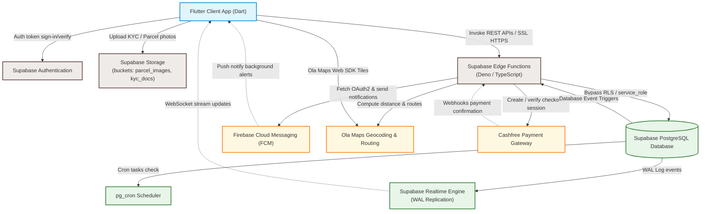

# WayDrop Technical Documentation — System Architecture

**Version:** 1.0  
**Last Updated:** July 5, 2026  
**Maintainer:** Lead System Architect  
**Applies To Commit:** 241d836  

---

## 1. System Topology Overview

WayDrop uses a **Serverless-First Server-Client Hybrid Architecture**. The client-side application is written in Flutter and interacts directly with a serverless backend hosted on Supabase. Heavy computation, third-party integrations (Cashfree, FCM), and security-sensitive steps are performed within isolated Supabase Edge Functions.

The system communicates through three key channels:
1. **REST API (Supabase & Edge Functions):** For stateless, transactional requests like order creation, payment generation, and KYC validation.
2. **WebSocket Channels (Postgres Realtime):** For state synchronization (e.g. tracking order status updates, receiving chat messages, and tracking active rider positions).
3. **Push Notifications (Firebase Cloud Messaging):** For asynchronous event delivery (e.g. alerting riders to nearby orders, notifying users of status updates, and support messages) when the app is in the background or closed.

---

## 2. Complete Architecture Diagram

The block diagram below details how the client client, authentication layer, database, edge functions, and external services are connected:

---

## 3. Core Architecture Sub-systems

### 3.1. Authentication Layer
- Handled via Supabase Phone OTP Auth.
- The phone number is verified, returning a JWT token.
- On successful login, the client receives the JWT token, which is attached to all subsequent REST requests (`Authorization: Bearer <JWT>`).
- Row Level Security (RLS) uses `auth.uid()` from this JWT to restrict query results.

### 3.2. Transactional API Pipeline
1. The Flutter client invokes a Supabase Edge Function via HTTPS.
2. The Edge Function verifies the JWT auth header to authenticate the caller.
3. The function performs third-party validations or calls (e.g. routing calculations on Ola Maps, payment initiation on Cashfree).
4. The function executes changes on PostgreSQL with elevated permissions (`service_role` client) to bypass RLS policies.
5. The function returns a JSON response to the client.

### 3.3. Real-time Database Synchronization
- The client establishes a single, multiplexed WebSocket connection to the Supabase Realtime service.
- The client subscribes to Postgres replication changes (`supabase_realtime` publication) on specific tables (e.g., `orders`, `rider_assignments`, `order_chat_messages`) filtered by columns (e.g., `user_id = auth.uid()` or `rider_id = <rider_id>`).
- When a database trigger or script alters a row, PostgreSQL writes the change to the Write-Ahead Log (WAL). The Realtime engine reads this log and pushes the update down the WebSocket to the client.

### 3.4. Payment Sub-system
- Coordinates between Flutter client, Supabase Edge Functions, Cashfree payment gateway, and PostgreSQL.
- State transitions are managed using the `payments` table and updated in real-time, providing immediate visual feedback in the client UI.

### 3.5. Notification Sub-system
- High-priority background alerts are dispatched via database triggers.
- Triggers invoke PostgreSQL functions that send HTTP POST requests to the `send-push-notification` edge function via the `pg_net` extension.
- The Edge function converts the payload, grabs device tokens from `user_device_tokens`, and delivers them using Google OAuth2 to the Firebase Cloud Messaging (FCM) API.
