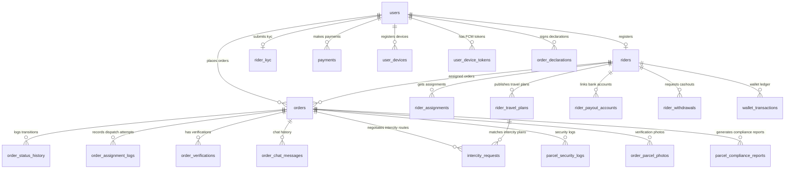

# WayDrop Technical Documentation — Database Schema Specification

**Version:** 1.0  
**Last Updated:** July 5, 2026  
**Maintainer:** Lead Database Administrator  
**Applies To Commit:** 241d836  

---

## 1. Complete Database Entity-Relationship (ER) Model

The WayDrop database structure is managed in the `public` schema on Supabase (PostgreSQL). It comprises 39 active tables tracking identity, geolocation, booking lifecycles, and transactions. Below is the relational model:

---

## 2. Comprehensive Table-by-Table Schema Specification

### 2.1. `public.users`
- **Purpose:** Core table storing all registered passenger and rider accounts.
- **Columns:**
  - `id` (uuid, Primary Key): Maps directly to `auth.users(id)`. Non-nullable.
  - `phone` (text, Unique): User's phone number. Nullable (allows test bypass setup).
  - `created_at` (timestamptz): Default to `timezone('utc'::text, now())`.
  - `full_name` (text): Full name of the user. Nullable.
  - `email` (text): Email address. Nullable.
  - `profile_completed` (boolean): Default is `false`. Flags whether they completed the initial onboarding form.
  - `onboarding_completed` (boolean): Default is `false`. Flags if they cleared permissions screens.
  - `preferred_mode` (USER-DEFINED): Mode selection. Default is `'user'::preferred_mode_enum` ('user' or 'rider').
  - `last_active_mode` (USER-DEFINED): Default `'user'::preferred_mode_enum`.
  - `role` (text): Default is `'user'::text`. Used to differentiate normal users and administrators.
  - `pref_order_notifications` (boolean): Default `true`. Notification toggle for order alerts.
  - `pref_chat_notifications` (boolean): Default `true`. Notification toggle for chat alerts.
  - `pref_rating_notifications` (boolean): Default `true`. Notification toggle for reviews.
  - `pref_admin_notifications` (boolean): Default `true`. Notification toggle for administrative messages.
  - `user_code` (text, Unique): Unique system identifier (e.g. `WDU123456`) generated via trigger.
  - `order_notification_mode` (text): Default `'important_only'::text`. Check constraint restricts to `all`, `important_only`, or `tracking_silent`.
- **Foreign Keys:**
  - `id` REFERENCES `auth.users(id)` ON DELETE CASCADE.
- **Indexes:**
  - `users_pkey` (Primary Key Index).
  - `users_phone_key` (Unique Index on `phone`).
  - `users_user_code_key` (Unique Index on `user_code`).

### 2.2. `public.admins`
- **Purpose:** Admin profiles authorized to access dashboard panels.
- **Columns:**
  - `id` (uuid, Primary Key): Default `gen_random_uuid()`.
  - `admin_code` (text, Unique): Admin registration code. Non-nullable.
  - `name` (text): Admin full name. Non-nullable.
  - `phone` (text, Unique): Contact number. Non-nullable.
  - `email` (text, Unique): Email. Non-nullable.
  - `password_hash` (text): Hashed password. Non-nullable.
  - `role` (text): Admin role level (e.g., `super_admin`, `moderator`). Non-nullable.
  - `permissions` (jsonb): JSON mapping of allowed operations. Default `'{}'::jsonb`.
  - `is_active` (boolean): Default `true`.
  - `is_account_locked` (boolean): Default `false`.
  - `last_login_at` (timestamptz): Timestamp of last active login.
  - `created_at` (timestamptz): Default `now()`.
- **Indexes:**
  - `admins_pkey` (Primary Key Index).
  - `admins_admin_code_key` (Unique Index).
  - `admins_phone_key` (Unique Index).
  - `admins_email_key` (Unique Index).

### 2.3. `public.admin_logs`
- **Purpose:** Audit ledger recording all administrative updates.
- **Columns:**
  - `id` (uuid, Primary Key): Default `gen_random_uuid()`.
  - `admin_id` (uuid): Reference to acting admin. Non-nullable.
  - `action_type` (text): Category of update (e.g., `kyc_approve`). Non-nullable.
  - `target_type` (text): Affected table model name. Non-nullable.
  - `target_id` (uuid): Primary key of target record. Non-nullable.
  - `description` (text): Explanation text.
  - `metadata` (jsonb): Dynamic audit details. Default `'{}'::jsonb`.
  - `ip_address` (text): Admin network location IP.
  - `user_agent` (text): Admin browser footprint.
  - `created_at` (timestamptz): Default `now()`.
- **Foreign Keys:**
  - `admin_id` REFERENCES `public.admins(id)`.

### 2.4. `public.rider_kyc`
- **Purpose:** Form details, government IDs, and verification photos for riders.
- **Columns:**
  - `id` (uuid, Primary Key): Default `gen_random_uuid()`.
  - `user_id` (uuid): Reference to registered user. Non-nullable.
  - `full_name` (text): Legal full name. Non-nullable.
  - `father_name` (text): Father's name. Non-nullable.
  - `vehicle_type` (USER-DEFINED): Vehicle type enum. Non-nullable.
  - `aadhaar_number` (text): Aadhaar card number. Must be exactly 12 characters.
  - `pan_number` (text): PAN card number. Must match regex `^[A-Z]{5}[0-9]{4}[A-Z]{1}$`.
  - `driving_license_number` (text): DL identifier. Non-nullable.
  - `vehicle_number` (text): Vehicle registration plate. Non-nullable.
  - `rider_image` (text): Selfie photo URL. Non-nullable.
  - `aadhaar_front_image` (text): Aadhaar front photo URL. Non-nullable.
  - `aadhaar_back_image` (text): Aadhaar back photo URL. Non-nullable.
  - `pan_front_image` (text): PAN front photo URL. Non-nullable.
  - `pan_back_image` (text): PAN back photo URL. Non-nullable.
  - `license_front_image` (text): DL front photo URL. Non-nullable.
  - `license_back_image` (text): DL back photo URL. Non-nullable.
  - `vehicle_image` (text): Vehicle photo URL. Non-nullable.
  - `kyc_status` (USER-DEFINED): Default `'pending'::kyc_status_enum`.
  - `activation_status` (USER-DEFINED): Default `'inactive'::activation_status_enum`.
  - `handled_by_admin_id` (uuid): Administrator who reviewed the KYC. Nullable.
  - `approved_at` (timestamptz): Approval timestamp.
  - `rejected_at` (timestamptz): Rejection timestamp.
  - `rejection_reason` (text): Reason for KYC rejection.
  - `activated_at` (timestamptz): Activation timestamp.
  - `created_at` (timestamptz): Default `now()`.
  - `updated_at` (timestamptz): Default `now()`.
  - `rejection_count` (integer): Default `0`. Number of KYC rejections.
  - `blocked_until` (timestamptz): Lockout timestamp (7 days after 2 rejections).
  - `date_of_birth` (date): Date of birth. Must be $\ge 18$ years old.
  - `VECHILE_RC_front_image` (text): RC front image URL.
  - `VECHILE_RC_back_image` (text): RC back image URL.
- **Foreign Keys:**
  - `user_id` REFERENCES `public.users(id)`.
  - `handled_by_admin_id` REFERENCES `public.admins(id)`.

### 2.5. `public.riders`
- **Purpose:** Location, performance metrics, and settings for active riders.
- **Columns:**
  - `id` (uuid, Primary Key): Default `gen_random_uuid()`.
  - `kyc_id` (uuid, Unique): Link to approved KYC. Non-nullable.
  - `user_id` (uuid, Unique): Link to profile user. Non-nullable.
  - `rating` (numeric): Current rating. Default `5`.
  - `total_orders` (integer): Default `0`.
  - `total_completed_orders` (integer): Default `0`.
  - `total_cancelled_orders` (integer): Default `0`.
  - `total_earnings` (numeric): Total earnings. Default `0`.
  - `today_earnings` (numeric): Daily earnings. Default `0`.
  - `wallet_balance` (numeric): Current balance. Default `0`.
  - `cod_pending_amount` (numeric): COD cash held. Default `0`.
  - `cod_limit` (numeric): Max COD allowed before lockout. Default `500`.
  - `account_status` (USER-DEFINED): Mode. Default `'offline'::rider_account_status_enum`.
  - `current_lat` (double precision): Live coordinate latitude.
  - `current_lng` (double precision): Live coordinate longitude.
  - `current_heading` (double precision): Live coordinate rotation angle.
  - `last_location_updated_at` (timestamptz): Live coordinate update timestamp.
  - `last_active_at` (timestamptz): Timestamp of last active ping.
  - `subscription_active` (boolean): Default `false`. WayDrop MAX status.
  - `subscription_expires_at` (timestamptz): Expiration of waydrop MAX.
  - `commission_waiver_active` (boolean): Default `false`.
  - `is_verified` (boolean): Verification flag. Default `true`.
  - `created_at` (timestamptz): Default `now()`.
  - `updated_at` (timestamptz): Default `now()`.
  - `last_dormant_notification_sent_at` (timestamptz): Tracker for Daily checks.
  - `last_sub_offline_notification_sent_at` (timestamptz): Tracker for Offline notifications.
- **Foreign Keys:**
  - `kyc_id` REFERENCES `public.rider_kyc(id)`.
  - `user_id` REFERENCES `public.users(id)`.

### 2.6. `public.payments`
- **Purpose:** Payment transaction ledger.
- **Columns:**
  - `id` (uuid, Primary Key): Default `gen_random_uuid()`.
  - `payment_code` (text, Unique): Unique payment code (`WDPYXXXXXX`). Non-nullable.
  - `user_id` (uuid): Payer user ID. Nullable.
  - `rider_id` (uuid): Target rider ID. Nullable.
  - `payment_for` (USER-DEFINED): Purpose of payment. Non-nullable.
  - `reference_id` (uuid): Link to the reference order or subscription. Nullable.
  - `amount` (numeric): Base transaction amount. Non-nullable.
  - `gst_amount` (numeric): GST portion. Default `0`.
  - `platform_fee` (numeric): Platform fee portion. Default `0`.
  - `discount_amount` (numeric): Discount applied. Default `0`.
  - `final_amount` (numeric): Total billed amount. Non-nullable.
  - `payment_method` (USER-DEFINED): Gateway selection. Non-nullable.
  - `payment_gateway` (text): Provider name (e.g. `cashfree`).
  - `gateway_transaction_id` (text): ID returned by payment gateway.
  - `gateway_order_id` (text): Order ID generated for the gateway.
  - `payment_status` (USER-DEFINED): Default `'pending'::payment_status_enum`.
  - `paid_at` (timestamptz): Success timestamp.
  - `refunded_at` (timestamptz): Refund timestamp.
  - `refund_reason` (text): Reason for refund.
  - `metadata` (jsonb): Default `'{}'::jsonb`.
  - `created_at` (timestamptz): Default `now()`.
  - `updated_at` (timestamptz): Default `now()`.
  - `rider_earning` (numeric): Rider portion. Default `0`.
  - `company_earning` (numeric): Platform portion. Default `0`.
  - `webhook_received` (boolean): Webhook receipt flag. Default `false`.
  - `webhook_payload` (jsonb): Full webhook payload payload.
  - `failure_reason` (text): Failure reason.
  - `settlement_reference` (text): Bank reference code.
  - `payment_source` (text): Payment instrument type (e.g., `UPI`, `CARD`).
- **Foreign Keys:**
  - `user_id` REFERENCES `public.users(id)`.
  - `rider_id` REFERENCES `public.riders(id)`.

### 2.7. `public.orders`
- **Purpose:** Central table managing rides, local parcel deliveries, and intercity requests.
- **Columns:**
  - `id` (uuid, Primary Key): Default `gen_random_uuid()`.
  - `order_code` (text, Unique): Unique prefixed order code (e.g., `WDR123456`).
  - `user_id` (uuid): Passenger/sender ID. Non-nullable.
  - `rider_id` (uuid): Assigned rider ID. Nullable.
  - `order_type` (USER-DEFINED): Booking service type. Non-nullable.
  - `vehicle_type` (USER-DEFINED): Vehicle type choice. Nullable.
  - `order_status` (USER-DEFINED): Default `'created'::order_status_enum`.
  - `pricing_config_id` (uuid): Pricing settings row ID. Nullable.
  - `distance_meters` (integer): Distance in meters. Must be $\ge 0$.
  - `distance_km` (numeric): Distance in km. Must be $\ge 0$.
  - `estimated_duration_min` (integer): Estimated duration.
  - `actual_duration_min` (integer): Actual duration.
  - `time_taken_seconds` (integer): Final duration in seconds.
  - `pickup_address` (text): Address name. Non-nullable.
  - `pickup_lat` (double precision): Latitude coordinates. Non-nullable.
  - `pickup_lng` (double precision): Longitude coordinates. Non-nullable.
  - `destination_address` (text): Destination address name. Non-nullable.
  - `destination_lat` (double precision): Destination latitude. Non-nullable.
  - `destination_lng` (double precision): Destination longitude. Non-nullable.
  - `actual_fare` (numeric): System fare calculation. Must be $\ge 0$.
  - `current_fare` (numeric): Fare before discount/promo. Must be $\ge 0$.
  - `final_fare` (numeric): Final billed fare. Must be $\ge 0$.
  - `base_fare` (numeric): Base pickup fare portion. Default `0`.
  - `distance_fare` (numeric): Distance fare portion. Default `0`.
  - `time_fare` (numeric): Duration fare portion. Default `0`.
  - `waiting_charge` (numeric): Waiting charge portion. Default `0`.
  - `platform_fee` (numeric): Platform fee portion. Default `0`.
  - `gst_percentage` (numeric): GST percentage. Default `0`.
  - `gst_amount` (numeric): GST amount. Default `0`.
  - `commission_percentage` (numeric): Commission percentage. Default `0`.
  - `commission_amount` (numeric): Commission amount. Default `0`.
  - `rider_earning` (numeric): Rider payout portion. Default `0`.
  - `boost_amount` (numeric): Voluntary boost added by passenger. Default `0`.
  - `subscription_commission_waived` (boolean): Commission waiver flag. Default `false`.
  - `pricing_snapshot` (jsonb): Snapshot of pricing parameters. Default `'{}'::jsonb`.
  - `payment_mode` (USER-DEFINED): Mode. Non-nullable.
  - `payment_status` (USER-DEFINED): Default `'pending'::payment_status_enum`.
  - `payment_id` (uuid): Link to transaction row. Nullable.
  - `pickup_otp` (text): OTP code for pickup confirmation.
  - `delivery_otp` (text): OTP code for delivery confirmation.
  - `search_expires_at` (timestamptz): Dispatch timeout deadline.
  - `cancelled_by` (USER-DEFINED): Cancellation source ('user', 'rider', 'admin', 'system').
  - `cancel_reason` (text): Explanation note.
  - `parcel_type` (USER-DEFINED): Parcel contents category. Nullable.
  - `receiver_name` (text): Receiver name. Nullable.
  - `receiver_phone` (text): Receiver phone. Nullable.
  - `weight_category` (text): Weight category code (e.g. `0_5`). Nullable.
  - `actual_weight_kg` (numeric): Measured weight. Nullable.
  - `parcel_images` (ARRAY): List of parcel photo URLs. Nullable.
  - `special_instructions` (text): Custom instructions. Nullable.
  - `created_at` (timestamptz): Default `now()`.
  - `updated_at` (timestamptz): Default `now()`.
  - `accepted_at` (timestamptz): Accept event timestamp.
  - `rider_arrived_at` (timestamptz): Arrival event timestamp.
  - `picked_up_at` (timestamptz): Pickup event timestamp.
  - `rider_at_drop_at` (timestamptz): Dropoff event timestamp.
  - `completed_at` (timestamptz): Completion event timestamp.
  - `cancelled_at` (timestamptz): Cancellation event timestamp.
  - `pickup_otp_attempts` (integer): Default `0`. OTP entry failures.
  - `delivery_otp_attempts` (integer): Default `0`. OTP entry failures.
  - `boost_company_earning` (numeric): Platform portion of boost. Default `0`.
  - `boost_rider_earning` (numeric): Rider portion of boost. Default `0`.
  - `boost_percentage` (numeric): Boost percentage. Default `0`.
  - `dispatch_attempts` (integer): Default `0`. Number of matching rounds run.
  - `boost_round` (integer): Default `0`. Current pricing escalation round.
  - `current_search_radius_km` (numeric): Default `3`. Geofence radius.
  - `last_dispatched_at` (timestamptz): Last dispatch attempt timestamp.
  - `rider_rejections_count` (integer): Default `0`. Number of rider rejections.
  - `redispatch_count` (integer): Default `0`. Number of dispatch restarts.
  - `pickup_city` (text): Pickup city name. Nullable.
  - `destination_city` (text): Destination city name. Nullable.
  - `travel_date` (timestamptz): Schedule time. Nullable.
  - `dispatch_state` (jsonb): State tracking variable. Default `'{}'::jsonb`.
  - `created_ip_address` (inet): IP address of order creator.
  - `created_lat` (double precision): Latitude coordinates of order creator.
  - `created_lng` (double precision): Longitude coordinates of order creator.
  - `sender_declaration_accepted` (boolean): Default `false`. Security agreement flag.
  - `sender_declaration_accepted_at` (timestamptz): Security agreement timestamp.
  - `pickup_verification_completed` (boolean): Default `false`. Verification photo flag.
  - `pickup_verification_completed_at` (timestamptz): Verification photo timestamp.
  - `compliance_flagged` (boolean): Default `false`. System flagging.
  - `compliance_notes` (text): Flag explanation note.
  - `created_device_ref` (text): Hardware reference hash.
  - `created_device_record_id` (uuid): Reference device row ID.
  - `created_device_model` (text): Model name (e.g. `iPhone 15`).
  - `created_device_brand` (text): Brand name (e.g. `Apple`).
  - `created_os_version` (text): OS version (e.g. `iOS 17.4`).
  - `created_app_version` (text): App version (e.g. `1.0.4`).
  - `compliance_status` (text): Default `'pending'::text`. Restricts to `pending`, `verified`, `flagged`, `investigating`.
  - `compliance_score` (integer): Score calculated by matching models. Default `100`.
  - `compliance_retention_until` (timestamptz): Expiry date for log retention.
  - `parcel_declared_value` (numeric): Estimated value declared by sender.
  - `high_risk_parcel` (boolean): Default `false`. High value or fragile item flag.
  - `dispatch_worker_running` (boolean): Lock variable preventing concurrent workers. Default `false`.
  - `dispatch_worker_started_at` (timestamptz): Timestamp of dispatch worker lock acquisition.
- **Foreign Keys:**
  - `user_id` REFERENCES `public.users(id)`.
  - `rider_id` REFERENCES `public.riders(id)`.
  - `pricing_config_id` REFERENCES `public.pricing_config(id)`.
  - `payment_id` REFERENCES `public.payments(id)`.
  - `created_device_record_id` REFERENCES `public.user_devices(id)`.

### 2.8. `public.rider_travel_plans`
- **Purpose:** Travel route listings published by riders for intercity matching.
- **Columns:**
  - `id` (uuid, Primary Key): Default `gen_random_uuid()`.
  - `rider_id` (uuid): Traveller rider profile ID. Non-nullable.
  - `pickup_city` (text): Source city. Non-nullable.
  - `destination_city` (text): Target city. Non-nullable.
  - `pickup_lat` (double precision): Latitude coordinates of source city.
  - `pickup_lng` (double precision): Longitude coordinates of source city.
  - `destination_lat` (double precision): Destination latitude.
  - `destination_lng` (double precision): Destination longitude.
  - `weight_preference` (text): Weight class preference (e.g., `0_5`, `26_50`).
  - `travel_date` (timestamptz): Scheduled travel date. Non-nullable.
  - `status` (USER-DEFINED): Default `'active'::travel_plan_status_enum`.
  - `created_at` (text): Default `now()` string.
  - `updated_at` (text): Default `now()` string.
  - `plan_code` (text, Unique): Plan code (e.g., `WDPN100234`).
  - `max_weight_kg` (numeric): Weight limit preference. Default `0`.
  - `max_bookings` (integer): Passenger seat limit. Default `3`.
  - `travel_plan_type` (text): Restricts to `ride`, `parcel`, or `both`. Default `'both'::text`.
  - `vehicle_type` (USER-DEFINED): Vehicle type enum. Nullable.
  - `route_geometry` (text): Path geometry string.
- **Foreign Keys:**
  - `rider_id` REFERENCES `public.riders(id)`.

### 2.9. `public.intercity_requests`
- **Purpose:** Bid negotiations, route bookings, and statuses for intercity orders.
- **Columns:**
  - `id` (uuid, Primary Key): Default `gen_random_uuid()`.
  - `parcel_id` (uuid): Reference order ID. Non-nullable.
  - `route_id` (uuid): Reference travel plan ID. Nullable.
  - `traveller_id` (uuid): Traveller rider ID. Non-nullable.
  - `sender_id` (uuid): Sender user ID. Non-nullable.
  - `initiated_by` (text): Source. Check restricts to `traveller` or `sender`.
  - `status` (text): Default `'request_sent'::text`. Check restricts to `request_sent`, `discussion_started`, `fare_agreed`, `confirmed`, `paid`, `expired`, `cancelled`, `rejected`.
  - `proposed_fare` (numeric): Bid fare. Non-nullable.
  - `sender_confirmed` (boolean): Default `false`. Sender acceptance flag.
  - `traveller_confirmed` (boolean): Default `false`. Rider acceptance flag.
  - `created_at` (timestamptz): Default `timezone('utc'::text, now())`.
  - `updated_at` (timestamptz): Default `timezone('utc'::text, now())`.
  - `booking_type` (text): Check restricts to `ride` or `parcel`.
  - `expires_at` (timestamptz): Expiration deadline. Default `24 hours` from creation.
  - `metadata` (jsonb): JSON payload metadata. Default `'{}'::jsonb`.
  - `expiry_reason` (text): Expiry reason code (`negotiation_timeout`, `travel_date_passed`, `no_show`).
- **Foreign Keys:**
  - `parcel_id` REFERENCES `public.orders(id)`.
  - `route_id` REFERENCES `public.rider_travel_plans(id)`.
  - `traveller_id` REFERENCES `public.riders(id)`.
  - `sender_id` REFERENCES `public.users(id)`.

### 2.10. `public.order_chat_messages`
- **Purpose:** Live chat messages for active orders.
- **Columns:**
  - `id` (uuid, Primary Key): Default `gen_random_uuid()`.
  - `order_id` (uuid): Link to active order. Nullable.
  - `rider_id` (uuid): Link to rider. Nullable.
  - `sender_id` (uuid): Link to sender. Non-nullable.
  - `sender_type` (text): Check restricts to `user`, `rider`, `admin`, `support`.
  - `message` (text): Message text. Non-nullable.
  - `created_at` (timestamptz): Default `timezone('utc'::text, now())`.
  - `is_support` (boolean): Support chat flag. Default `false`.
  - `user_id` (uuid): Link to user. Nullable.
  - `message_type` (text): Check restricts to `text`, `offer`, `image`, `location`. Default `'text'::text`.
  - `metadata` (jsonb): Rich message metadata (lat/lng coordinates, offer amounts). Default `'{}'::jsonb`.
- **Foreign Keys:**
  - `order_id` REFERENCES `public.orders(id)`.
  - `rider_id` REFERENCES `public.riders(id)`.
  - `sender_id` REFERENCES `auth.users(id)`.
  - `user_id` REFERENCES `public.users(id)`.

---

## 3. Supplementary System Tables (Brief Catalog)

### 3.1. `public.user_devices`
- **Purpose:** Unique hardware registrations used to verify logins and track device limits.
- **Key Columns:** `id` (PK), `user_id` (FK), `device_id` (Unique), `device_ref` (Unique), `device_model`, `device_brand`, `os_version`, `app_version`, `is_active` (Default `true`).

### 3.2. `public.user_device_tokens`
- **Purpose:** Active FCM push tokens used to send notifications to devices.
- **Key Columns:** `id` (PK), `user_id` (FK), `fcm_token` (Unique), `device_type`, `user_device_id` (FK to `user_devices`).

### 3.3. `public.pricing_zones`
- **Purpose:** Location coordinate boundaries used to determine service zones.
- **Key Columns:** `id` (PK), `zone_code` (Unique), `zone_name`, `zone_type`, `cities` (text array), `center_lat`, `center_lng`, `radius_km`, `zone_shape` (Default `radius`).

### 3.4. `public.pricing_config`
- **Purpose:** Pricing parameters (flag drops, commission splits) for each service zone.
- **Key Columns:** `id` (PK), `pricing_code` (Unique), `pricing_zone_id` (FK), `commission_percentage`, `gst_percentage` (Default `5`), `max_boost_percentage` (Default `50`), `pricing_rules` (JSONB).

### 3.5. `public.dispatch_config`
- **Purpose:** Timeout values, search radii, and batch limits for the matching loop.
- **Key Columns:** `id` (PK), `config_code` (Unique), `round_1_radius_km` (Default `3`), `round_1_batch_size` (Default `3`), `round_2_radius_km` (Default `6`), `round_2_batch_size` (Default `5`), `rider_response_timeout_sec` (Default `25`), `max_search_duration_sec` (Default `900`).

### 3.6. `public.rider_payout_accounts`
- **Purpose:** Rider bank accounts and UPI VPA mappings for Cashfree withdrawals.
- **Key Columns:** `id` (PK), `rider_id` (FK), `user_id` (FK), `beneficiary_id` (Unique), `beneficiary_name`, `account_number`, `ifsc_code`, `upi_vpa`, `cashfree_beneficiary_status`, `payout_method`.

### 3.7. `public.rider_withdrawals`
- **Purpose:** Withdrawal transactions requested by riders.
- **Key Columns:** `id` (PK), `rider_id` (FK), `user_id` (FK), `amount`, `transfer_id` (Unique), `status` (Default `pending`), `cashfree_reference_id`.

### 3.8. `public.rider_reviews`
- **Purpose:** Customer ratings and reviews for riders.
- **Key Columns:** `id` (PK), `order_id` (FK, Unique), `rider_id` (FK), `user_id` (FK to `auth.users`), `rating` (1–5), `comment`.

### 3.9. `public.wallet_transactions`
- **Purpose:** Ledger tracking rider wallet changes (credits, debits, adjustments).
- **Key Columns:** `id` (PK), `rider_id` (FK), `amount` (Credits are positive, debits negative), `type` (`credit`, `debit`, `bonus`, `settlement`, `adjustment`), `reference_id` (UUID reference to order/withdrawal).

### 3.10. `public.notifications`
- **Purpose:** Notification outbox. Triggers send these rows to FCM.
- **Key Columns:** `id` (PK), `user_id` (FK), `title`, `body`, `notification_type`, `is_read` (Default `false`), `push_sent` (Default `false`), `delivery_status` (Default `pending`).

### 3.11. `public.order_verifications`
- **Purpose:** Pickup/dropoff confirmations and verification details.
- **Key Columns:** `id` (PK), `order_id` (FK), `verification_type` (`pickup`, `dropoff`, `damage_report`, `signature`), `verification_status` (Default `verified`), `photo_url`, `latitude`, `longitude`.

---

## 4. Key Indexes & Constraints Catalog

To maintain database performance and data integrity, the schema defines the following indexes and constraints:

- **Composite Index `idx_orders_status_rider`:** Created on `orders(order_status, rider_id)`. Used to quickly retrieve active bookings assigned to a specific rider.
- **Unique Constraint `unique_order_rider_assignment`:** Configured on `order_assignment_logs(order_id, rider_id, assignment_round)`. Prevents duplicate dispatch log rows for the same round.
- **Check Constraint `date_of_birth` on `rider_kyc`:** `CHECK (date_of_birth <= (CURRENT_DATE - '18 years'::interval))`. Enforces the minimum rider age limit of 18.
- **Check Constraint `pan_number` on `rider_kyc`:** `CHECK (pan_number ~ '^[A-Z]{5}[0-9]{4}[A-Z]{1}$'::text)`. Enforces the official Indian Income Tax Department PAN format.
