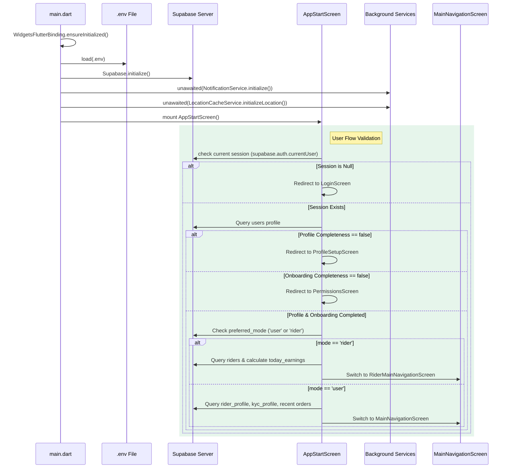

# WayDrop Flutter Codebase — Core App Lifecycle & Line-by-Line Code Specifications

**Version:** 1.0  
**Last Updated:** July 5, 2026  
**Maintainer:** Lead Flutter Systems Architect  
**Applies To Commit:** 241d836  

---

## 1. Application Architecture & Startup Sequence

WayDrop's entry execution flows from `main.dart` through the initialization checks in `AppStartScreen` to the primary navigation stacks. The startup sequence is designed to run non-blocking setups in the background, allowing the app to launch quickly while ensuring critical connections are verified.

---

## 2. Line-by-Line Code Specifications

### 2.1. File: `main.dart`

This file is the root entry point of the Flutter application. It configures initialization, establishes error monitoring zones, and sets up dynamic theme routing.

* **Line 24 (`Future<void> main() async`)**  
  Entry point of the Dart program. Marked `async` because it must await database and storage initializations.
* **Line 25 (`runZonedGuarded(...)`)**  
  Executes the application inside a monitored zone. Any unhandled asynchronous exceptions (such as network timeouts or background thread crashes) are caught by the error callback block on line 95, preventing silent crashes and routing errors to crash logging tools like Sentry or Firebase Crashlytics.
* **Line 27 (`WidgetsFlutterBinding.ensureInitialized()`)**  
  Ensures the Flutter framework is bound to the native engine. This must be called before running native code plugins (like SQLite, shared preferences, or Firebase) during app startup.
* **Lines 30–38 (`SystemChrome.setEnabledSystemUIMode` and `setSystemUIOverlayStyle`)**  
  Configures the native system UI to run edge-to-edge. Status bars and navigation bars are set to transparent with `systemNavigationBarContrastEnforced: false` to allow the Flutter UI to render behind them.
* **Line 40 (`await dotenv.load(fileName: ".env")`)**  
  Loads the environment configuration keys (Supabase keys, API endpoints, Ola Maps tokens) from the `.env` file into memory.
* **Lines 46–49 (`await Supabase.initialize(...)`)**  
  Connects to the Supabase backend using the URL and public Anon Key loaded from environment variables.
* **Line 54 (`await CacheService.instance.init()`)**  
  Initializes the `SharedPreferences` key-value store instance used for offline settings.
* **Line 57 (`unawaited(FeatureFlagService.instance.init())`)**  
  Starts feature flag caching. Wrapped in `unawaited` so it runs in the background and does not block the main startup thread.
* **Line 59 (`PaymentService.initializeCallbacks()`)**  
  Binds Cashfree payment event listeners to handle webhooks and gateway callback responses.
* **Line 62 (`unawaited(NotificationService().initialize())`)**  
  Starts Firebase Cloud Messaging initialization in the background, requesting push notifications permissions and registering token listeners.
* **Lines 68–70 (`LocationCacheService.initializeLocation()`)**  
  Sets up the local SQLite database for location logs. Run asynchronously to avoid blocking the main thread.
* **Lines 75–79 (`FlutterError.onError`)**  
  Captures synchronous Flutter framework errors. It outputs the stack trace to the console via `presentError` and records crashes in crash reporting tools in production.
* **Line 86 (`debugPrint = (String? message, ...) {}`)**  
  Overrides the default console printing behavior. In production, this silences all console logs to prevent sensitive details (such as tokens, session data, or coordinates) from leaking.
* **Lines 89–93 (`UncontrolledProviderScope`)**  
  Instantiates the Riverpod state container. It uses the pre-created `providerContainer` on Line 21, making state variables accessible globally.
* **Line 114 (`final appMode = ref.watch(appModeProvider)`)**  
  Observes changes in the active mode. Toggling modes triggers a rebuild of the root widget with the corresponding theme.
* **Lines 133–158 (`riderTheme`)**  
  Defines the dark theme palette for riders. It uses Google Fonts' Plus Jakarta Sans typography, a dark blue background (`0xFF0B0F19`), and a lime green primary color (`0xFFC5FF30`).
* **Lines 160–187 (`userLightTheme`)**  
  Defines the light theme palette for passengers. It uses an emerald green primary (`0xFF1B7A44`) and gold accent (`0xFFD4AF37`).
* **Lines 196–198 (`MaterialApp.builder`)**  
  Wraps the entire application widget tree in `ConnectivityWrapper` (for offline detection) and `ModeSwitchOverlay` (to animate screen transitions during role changes).
* **Line 199 (`home: const AppStartScreen()`)**  
  Sets `AppStartScreen` as the initial landing screen of the app.

---

### 2.2. File: `app_start_screen.dart`

This class acts as an initialization guard, validating user sessions and routing them to the correct onboarding or navigation screen.

* **Lines 37–42 (`initState()`)**  
  Runs initial configurations. Sets `currentScreen` to the brand splash view, runs the auth flow checks (`checkUserFlow`), and registers listeners to detect authentication updates.
* **Line 45 (`supabase.auth.onAuthStateChange.listen(...)`)**  
  Subscribes to session updates. Login or logout events trigger `checkUserFlow` to update the active view.
* **Lines 61–64 (`ServiceabilityService.loadActiveZones()`)**  
  Fetches serviceable geofence zones from the database. Run asynchronously using `unawaited` so they are cached and ready when the home screen loads.
* **Lines 66–71 (`final user = supabase.auth.currentUser`)**  
  Retrieves the current Supabase session. If no user is logged in, it routes to `LoginScreen`.
* **Lines 77–82 (`final profile = await supabase.from('users').select().eq('id', user.id).maybeSingle()`)**  
  Queries the user's profile row from the `users` table. Includes an 8-second timeout limit using `.timeout()` to handle slow connections.
* **Lines 90–107 (`final isSuspended = profile['is_suspended'] ?? false`)**  
  Checks if the user's account is suspended. If suspended, it signs out of Supabase, clears cached data, routes back to the login page, and displays an alert snackbar.
* **Lines 111–124 (`profileCompleted` and `onboardingCompleted`)**  
  Evaluates onboarding completion:
  - If the profile form is incomplete, routes to `ProfileSetupScreen`.
  - If permissions are missing, routes to `PermissionsScreen`.
* **Lines 132–176 (`preferredMode == 'rider'`)**  
  If the user's preferred mode is rider:
  - Queries the `riders` table to fetch active coordinates and vehicle details.
  - Queries completed orders to calculate today's earnings.
  - Sets the `initialRiderDataProvider` state.
  - Switch mode state to rider and routes the user to `RiderMainNavigationScreen`.
* **Lines 181–222 (`preferredMode == 'user'`)**  
  If the preferred mode is passenger:
  - Runs queries in parallel using `Future.wait` to pre-fetch the rider profile, KYC records, and recent orders.
  - Sets the `initialUserDataProvider` state.
  - Switch mode state to user and routes the user to `MainNavigationScreen`.
* **Lines 229–234 (`on TimeoutException catch (_)`)**  
  Handles connection timeouts by displaying `ConnectionErrorScreen` with retry triggers.
* **Lines 249–258 (`changeScreen(Widget screen, [DateTime? startTime])`)**  
  Transitions between screens. Ensures the splash view is displayed for at least 800ms to allow animations to complete.
* **Lines 444–478 (`RouteMotifPainter`)**  
  Draws animated coordinate path vector lines on the splash screen background.

---

### 2.3. File: `main_navigation_screen.dart`

This screen coordinates navigation for the passenger flow, managing index changes and keeping tab views active.

* **Line 23 (`int currentIndex = 0`)**  
  Tracks the active tab index.
* **Line 24 (`final GlobalKey<ActivityTabState> activityTabKey = GlobalKey<ActivityTabState>()`)**  
  Maintains a reference to the `ActivityTab` state, allowing the parent screen to refresh the order history list.
* **Lines 26–33 (`setIndex(int index)`)**  
  Updates the active tab index. If tab index 2 (Activity) is tapped, it calls `activityTabKey.currentState?.loadOrders(showLoading: false)` to refresh booking lists.
* **Lines 40–45 (`initState()`)**  
  Initializes the screens array:
  - `HomeTab`
  - `ServicesTab`
  - `ActivityTab` (assigned `activityTabKey` to allow manual reloads)
  - `ProfileTab`
* **Lines 53–63 (`SystemChrome.setSystemUIOverlayStyle`)**  
  Dynamically updates system status bar icon colors (light vs dark mode) as the user switches between tabs.
* **Lines 70–73 (`IndexedStack(...)`)**  
  Renders tab screens in a stack. The active view is selected using `index: currentIndex`. This preserves screen states and scroll positions when switching tabs.
* **Line 78 (`CustomCurvedNavigationBar`)**  
  Renders the animated curved bottom tab bar. Tapping a tab calls `setIndex` to update the active view.
* **Lines 84–104 (`CustomNavBarItem`)**  
  Defines layout icons and labels for the navigation tabs.
