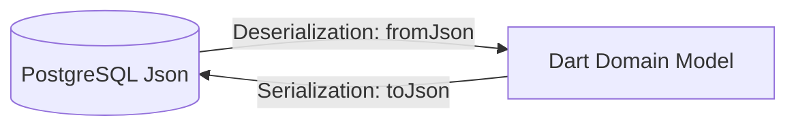

# WayDrop Flutter Codebase — Models Layer Specifications

**Version:** 1.0  
**Last Updated:** July 5, 2026  
**Maintainer:** Lead Data Architect  
**Applies To Commit:** 241d836  

---

## 1. Domain Modeling & Serialization Architecture

The Models layer (`lib/models/`) defines type-safe Dart classes that represent core database entities. These classes handle serialization (`toJson`) and deserialization (`fromJson`), including type coercion (e.g. converting double precision database numbers to Dart double values safely) and default fallback values to prevent UI crashes.



---

## 2. Complete Model & Enum Catalog

### 2.1. `TransportOrder`
- **File Location:** `lib/models/transport_order.dart`
- **Purpose:** Represents a ride, local parcel, or intercity request order.
- **Properties:**
  - `id` (String): Unique order UUID.
  - `orderCode` (String): Human-readable code (e.g. `WDR100234`).
  - `userId` (String): Passenger/sender UUID.
  - `riderId` (String?): Assigned rider UUID. Nullable if searching.
  - `orderType` (String): The booking category (`ride`, `local_parcel`, `intercity_parcel`, `intercity`).
  - `vehicleType` (String?): Requested vehicle type (`bike`, `auto`, `cab`).
  - `orderStatus` (String): Live trip state (`created`, `accepted`, `rider_arrived`, `picked_up`, `ongoing`, `rider_at_drop`, `completed`, `cancelled`).
  - `distanceMeters` (int): Total path distance in meters.
  - `distanceKm` (double): Route distance in kilometers.
  - `estimatedDurationMin` (int?): Estimated duration.
  - `actualDurationMin` (int?): Actual duration.
  - `timeTakenSeconds` (int?): Total trip time.
  - `pickupAddress` (String): Pickup address name.
  - `pickupLat` / `pickupLng` (double): Coordinates.
  - `destinationAddress` (String): Dropoff address name.
  - `destinationLat` / `destinationLng` (double): Coordinates.
  - `actualFare` (double): Billed fare.
  - `currentFare` (double): Fare before discounts.
  - `finalFare` (double?): Billed fare.
  - `baseFare` (double): Base fare portion.
  - `distanceFare` (double): Distance charge portion.
  - `timeFare` (double): Duration charge portion.
  - `waitingCharge` (double): Waiting fee portion.
  - `platformFee` (double): Platform fee.
  - `paymentMode` (String): Payment method (`cash`, `online`).
  - `paymentStatus` (String): Payment status (`pending`, `paid`, `refunded`, `failed`).
  - `paymentId` (String?): Link to transaction row.
  - `pickupOtp` (String?): OTP code for pickup confirmation.
  - `deliveryOtp` (String?): OTP code for delivery confirmation.
  - `parcelType` (String?): Description of parcel contents.
  - `receiverName` (String?): Receiver contact name.
  - `receiverPhone` (String?): Receiver contact phone number.
  - `weightCategory` (String?): Weight category code.
  - `actualWeightKg` (double?): Measured weight in kg.
  - `parcelImages` (List<String>): List of verification photo URLs.
  - `specialInstructions` (String?): Rider instructions.
  - `createdAt` / `acceptedAt` / `completedAt` (DateTime?): Timestamps.
  - `boostAmount` (double): Voluntary fare boost.
  - `boostPercentage` (double): Boost percentage.
  - `pickupCity` / `destinationCity` (String?): Service cities.
  - `travelDate` (DateTime?): Planned departure date for intercity rides.
  - `seatsRequested` (int): Number of requested seats. Default `1`.
  - `gstPercentage` (double): GST rate.
  - `gstAmount` (double): GST amount.
  - `commissionPercentage` (double): Commission rate.
  - `commissionAmount` (double): Commission amount.
  - `riderEarning` (double): Rider payout portion.
  - `boostCompanyEarning` (double): Platform portion of boost.
  - `boostRiderEarning` (double): Rider portion of boost.
  - `surgeFee` (double): Surge pricing fee.
  - `rainFee` (double): Weather-related fee.

- **JSON Parser Code:**
  ```dart
  factory TransportOrder.fromJson(Map<String, dynamic> json) {
    return TransportOrder(
      id: json['id'] as String,
      orderCode: json['order_code'] as String,
      userId: json['user_id'] as String,
      riderId: json['rider_id'] as String?,
      orderType: json['order_type'] as String,
      vehicleType: json['vehicle_type'] as String?,
      orderStatus: json['order_status'] as String,
      distanceMeters: json['distance_meters'] as int? ?? 0,
      distanceKm: (json['distance_km'] as num?)?.toDouble() ?? 0.0,
      estimatedDurationMin: json['estimated_duration_min'] as int?,
      actualDurationMin: json['actual_duration_min'] as int?,
      timeTakenSeconds: json['time_taken_seconds'] as int?,
      pickupAddress: json['pickup_address'] as String,
      pickupLat: (json['pickup_lat'] as num).toDouble(),
      pickupLng: (json['pickup_lng'] as num).toDouble(),
      destinationAddress: json['destination_address'] as String,
      destinationLat: (json['destination_lat'] as num).toDouble(),
      destinationLng: (json['destination_lng'] as num).toDouble(),
      actualFare: (json['actual_fare'] as num).toDouble(),
      currentFare: (json['current_fare'] as num).toDouble(),
      finalFare: (json['final_fare'] as num?)?.toDouble(),
      baseFare: (json['base_fare'] as num? ?? 0).toDouble(),
      distanceFare: (json['distance_fare'] as num? ?? 0).toDouble(),
      timeFare: (json['time_fare'] as num? ?? 0).toDouble(),
      waitingCharge: (json['waiting_charge'] as num? ?? 0).toDouble(),
      platformFee: (json['platform_fee'] as num? ?? 0).toDouble(),
      paymentMode: json['payment_mode'] as String,
      paymentStatus: json['payment_status'] as String,
      paymentId: json['payment_id'] as String?,
      pickupOtp: json['pickup_otp'] as String?,
      deliveryOtp: json['delivery_otp'] as String?,
      parcelType: json['parcel_type'] as String?,
      receiverName: json['receiver_name'] as String?,
      receiverPhone: json['receiver_phone'] as String?,
      weightCategory: json['weight_category'] as String?,
      actualWeightKg: (json['actual_weight_kg'] as num?)?.toDouble(),
      parcelImages: (json['parcel_images'] as List<dynamic>?)?.map((e) => e.toString()).toList() ?? [],
      specialInstructions: json['special_instructions'] as String?,
      createdAt: json['created_at'] != null ? DateTime.parse(json['created_at'] as String) : null,
      acceptedAt: json['accepted_at'] != null ? DateTime.parse(json['accepted_at'] as String) : null,
      riderArrivedAt: json['rider_arrived_at'] != null ? DateTime.parse(json['rider_arrived_at'] as String) : null,
      pickedUpAt: json['picked_up_at'] != null ? DateTime.parse(json['picked_up_at'] as String) : null,
      riderAtDropAt: json['rider_at_drop_at'] != null ? DateTime.parse(json['rider_at_drop_at'] as String) : null,
      completedAt: json['completed_at'] != null ? DateTime.parse(json['completed_at'] as String) : null,
      cancelledAt: json['cancelled_at'] != null ? DateTime.parse(json['cancelled_at'] as String) : null,
      boostAmount: (json['boost_amount'] as num? ?? 0).toDouble(),
      boostPercentage: (json['boost_percentage'] as num? ?? 0).toDouble(),
      pickupCity: json['pickup_city'] as String?,
      destinationCity: json['destination_city'] as String?,
      travelDate: json['travel_date'] != null ? DateTime.parse(json['travel_date'] as String) : null,
      seatsRequested: json['seats_requested'] as int? ?? 1,
      gstPercentage: (json['gst_percentage'] as num? ?? 0).toDouble(),
      gstAmount: (json['gst_amount'] as num? ?? 0).toDouble(),
      commissionPercentage: (json['commission_percentage'] as num? ?? 0).toDouble(),
      commissionAmount: (json['commission_amount'] as num? ?? 0).toDouble(),
      riderEarning: (json['rider_earning'] as num? ?? 0).toDouble(),
      boostCompanyEarning: (json['boost_company_earning'] as num? ?? 0).toDouble(),
      boostRiderEarning: (json['boost_rider_earning'] as num? ?? 0).toDouble(),
      surgeFee: (json['surge_fee'] as num? ?? 0).toDouble(),
      rainFee: (json['rain_fee'] as num? ?? 0).toDouble(),
    );
  }
  ```

---

### 2.2. Enums & Helpers

#### `OrderFlowType`
- **Purpose:** Defines the navigation context and screen layout variants.
- **Values:**
  - `ride`: Local passenger trip.
  - `localParcel`: Local courier package delivery.
  - `intercityParcel`: Intercity package delivery.
  - `intercity`: Intercity passenger trip.

#### `TrackingCTA`
- **Purpose:** Action controls for live order tracking bottom sheets.
- **Values:**
  - `none`: Hide action button.
  - `callRider`: Open device dialer with rider's contact details.
  - `cancelOrder`: Open cancellation confirmation sheet.
  - `shareTripDetails`: Open share dialog with a tracking link.
  - `payOnline`: Initiate Cashfree payment.

---

### 2.3. `PaymentFor`
- **File Location:** `lib/models/payment_for.dart`
- **Purpose:** Defines the transaction target in the payments ledger.
- **Values:**
  - `ride_fare`: Trip payment.
  - `parcel_fare`: Local courier payment.
  - `subscription_fee`: WayDrop MAX subscription fee.
  - `wallet_topup`: Digital wallet top-up.
- **String Conversions:** Contains extensions to serialize enums to database codes and convert codes back to enums.

---

### 2.4. `MapSearchResult`
- **File Location:** `lib/models/map_search_result.dart`
- **Purpose:** Represents place options returned by the autocomplete address search.
- **Properties:**
  - `id` (String): Place reference.
  - `addressText` (String): Short location name.
  - `detailsText` (String): Full formatted address string.
  - `latitude` (double): Coordinate latitude.
  - `longitude` (double): Coordinate longitude.
