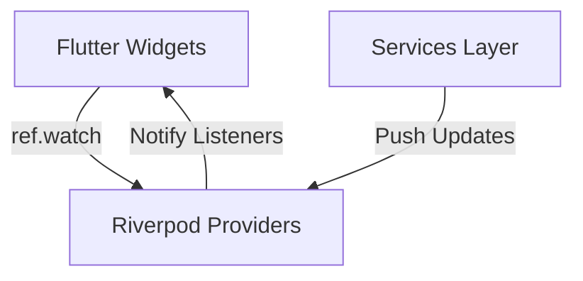

# WayDrop Flutter Codebase — State Providers Specifications

**Version:** 1.0  
**Last Updated:** July 5, 2026  
**Maintainer:** State Management Architect  
**Applies To Commit:** 241d836  

---

## 1. State Management Design Principles

WayDrop uses **Flutter Riverpod** for state management. This architecture decouples business logic and database network streams from UI widgets, ensuring responsive updates.



---

## 2. Global State Providers Catalog

### 2.1. `appModeProvider`
- **File Location:** `lib/core/providers/app_mode_provider.dart`
- **Provider Definition:** `final appModeProvider = StateNotifierProvider<AppModeNotifier, AppMode>((ref) => AppModeNotifier());`
- **State Type:** `AppMode` enum (`user`, `rider`).
- **Notifier Class:** `AppModeNotifier`
  - **Methods:**
    - `switchToUser()`: Sets state to `AppMode.user`.
    - `switchToRider()`: Sets state to `AppMode.rider`.
    - `toggle()`: Toggles state between passenger and rider modes.
- **Connections & Flow:**
  - Observed by `MainNavigationScreen` to select the primary navigation tree.
  - Read by `profile_tab.dart` and `rider_profile_tab.dart` to trigger mode switches.
  - Toggling mode triggers `ModeSwitchOverlay` to display the loading screen.

---

### 2.2. `initialUserDataProvider`
- **File Location:** `lib/core/providers/initial_data_provider.dart`
- **Provider Definition:** `final initialUserDataProvider = StateProvider<InitialUserData?>((ref) => null);`
- **State Type:** `InitialUserData` class.
- **Connections & Flow:**
  - Pre-fetched at app startup during `AppStartScreen`.
  - Holds `userProfile`, `riderProfile`, `kycProfile`, and `recentOrders` metadata.
  - Used by `HomeTab` and booking screens to check onboarding status and retrieve contact details.

---

### 2.3. `initialRiderDataProvider`
- **File Location:** `lib/core/providers/initial_data_provider.dart`
- **Provider Definition:** `final initialRiderDataProvider = StateProvider<InitialRiderData?>((ref) => null);`
- **State Type:** `InitialRiderData` class.
- **Connections & Flow:**
  - Holds active rider profile stats, today's earnings, and wallet balances.
  - Used by `RiderHomeTab` and `RiderEarningsTab` to display earnings metrics and check wallet balances.

---

### 2.4. `activeAssignmentsCountProvider`
- **File Location:** `lib/core/providers/initial_data_provider.dart`
- **Provider Definition:** `final activeAssignmentsCountProvider = StateProvider<int>((ref) => 0);`
- **State Type:** `int`
- **Connections & Flow:**
  - Stores the number of active order offers sent to the rider.
  - Updated by `RiderOrdersScreen` when checking for new assignments.
  - Updated by `NotificationService` when a new order offer notification arrives.
  - Displayed on the tab bar in `RiderMainNavigationScreen` to show a notification badge count.

---

### 2.5. `modeSwitchOverlayProvider`
- **File Location:** `lib/shared/mode_switch_overlay.dart`
- **Provider Definition:** `final modeSwitchOverlayProvider = StateNotifierProvider<ModeSwitchOverlayNotifier, ModeSwitchOverlayState?>((ref) => ModeSwitchOverlayNotifier());`
- **Notifier Class:** `ModeSwitchOverlayNotifier`
  - **Methods:**
    - `trigger(String message)`: Activates the overlay and displays a loading message.
    - `reset()`: Resets the state to hide the overlay.
- **Connections & Flow:**
  - Used by `HomeTab` and `RiderProfileTab` to display transition screens during mode changes.

---

### 2.6. `themeProvider`
- **File Location:** `lib/core/providers/theme_provider.dart`
- **Provider Definition:** `final themeProvider = StateNotifierProvider<ThemeNotifier, ThemeMode>((ref) => ThemeNotifier());`
- **Notifier Class:** `ThemeNotifier`
  - **Methods:**
    - `toggleTheme()`: Toggles the app between light and dark themes.
- **Connections & Flow:**
  - Used by `main.dart` to apply theme configurations.
  - Accessed via the user settings screen to update preference settings.

---

## 3. Data Flow Integration Examples

Below is a detailed trace of the data flow and state updates during key application events:

### 3.1. Mode Switch Data Flow
1. **User Action:** The user taps the "Switch to Rider" button on the passenger profile tab.
2. **Trigger:** `profile_tab.dart` calls `ref.read(modeSwitchOverlayProvider.notifier).trigger("Entering Rider Mode...")`.
3. **Overlay Re-render:** `ModeSwitchOverlay` detects the state change, displays the loading overlay, and starts the switch animation.
4. **State Transition:** `profile_tab.dart` calls `ref.read(appModeProvider.notifier).switchToRider()`.
5. **UI Navigation:** `MainNavigationScreen` detects the change to `AppMode.rider` and updates the navigation tree.
6. **Overlay Dismissal:** The switch animation completes, and the overlay is dismissed using `ref.read(modeSwitchOverlayProvider.notifier).reset()`.

### 3.2. Order Assignment Badge Count Flow
1. **Database Event:** A database trigger creates a new row in `rider_assignments` for an order.
2. **Push Notification:** The `send-push-notification` Edge Function receives the event and sends a notification to the rider's device via FCM.
3. **FCM Handler:** `NotificationService.initialize()` intercepts the message. If the app is in the foreground, it extracts `message.data['type'] == 'order_assignment'` and updates the count:
   ```dart
   final currentCount = providerContainer.read(activeAssignmentsCountProvider);
   providerContainer.read(activeAssignmentsCountProvider.notifier).state = currentCount + 1;
   ```
4. **UI Update:** `RiderMainNavigationScreen` detects the count change and updates the tab badge count automatically.
