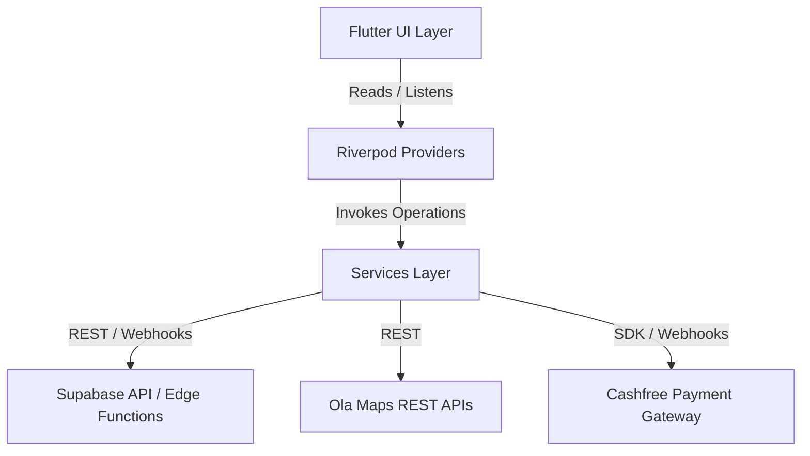

# WayDrop Flutter Codebase — Services Layer Documentation

**Version:** 1.0  
**Last Updated:** July 5, 2026  
**Maintainer:** Lead Core Services Developer  
**Applies To Commit:** 241d836  

---

## 1. Services Architecture Overview

The Services layer (`lib/core/services/`) manages all external integrations (Supabase, Firebase FCM, Ola Maps, Cashfree) and device features (location tracking, SQLite caching, Picture-in-Picture). These services act as singletons or static utilities and are called by Riverpod Providers to update the application state.

---

## 2. Comprehensive Service Specification Catalog

### 2.1. `SupabaseService`
- **File Location:** `lib/core/services/database/supabase_service.dart`
- **Purpose:** Core wrapper for Supabase authentication and profile creation.
- **Dependencies:** `supabase_flutter`
- **Key Methods:**
  - `sendOtp(String phone)`: Formats the phone number using `formatPhone` and calls `client.auth.signInWithOtp` to send a verification code.
  - `verifyOtp(String phone, String token)`: Verifies the code with `client.auth.verifyOTP`. On success, it inserts the user's UUID and phone into the `users` table via upsert.
  - `formatPhone(String phone)`: Standardizes input into the E.164 format (e.g. adding `+91` prefix for Indian numbers).
- **Connections:** Called by the login screens and auth providers. It writes directly to the `auth.users` and `public.users` tables.

---

### 2.2. `OlaMapService`
- **File Location:** `lib/core/services/maps/ola_map_service.dart`
- **Purpose:** Provides geocoding, autocomplete search, and routing queries using the Ola Maps REST APIs.
- **Dependencies:** `dio`, `flutter_dotenv`
- **Key Methods:**
  - `autocomplete(String input)`: Returns a list of place suggestions matching the text input. Caches results in `_autocompleteCache` to reduce API usage.
  - `reverseGeocode(double lat, double lng)`: Resolves coordinates into an address. Caches results in `_reverseGeocodeCache`.
  - `fetchRoute(double startLat, double startLng, double endLat, double endLng)`: Queries the Ola Routing API to calculate distance (meters), duration (seconds), and the route polyline path.
- **Connections:** Called by `AddressSelectionScreen`, `FarePreviewSheet`, and the tracking map widgets.

---

### 2.3. `NotificationService`
- **File Location:** `lib/modules/notifications/services/notification_service.dart`
- **Purpose:** Manages Firebase Cloud Messaging (FCM) registration, background handlers, and local alerts.
- **Dependencies:** `firebase_core`, `firebase_messaging`, `flutter_local_notifications`
- **Key Methods:**
  - `initialize()`: Sets up background handlers, requests push permissions, and configures notification channels.
  - `requestPermissions()`: Requests notification permissions on iOS and Android.
  - `handleNotificationTap(Map<String, dynamic> data)`: Parses payload keys and routes the user to the active tracking screen or chat view.
- **Connections:** 
  - Receives alerts from database triggers through the `send-push-notification` Edge Function.
  - Integrates with `activeAssignmentsCountProvider` to update rider badges when new orders are offered in the foreground.

---

### 2.4. `LocationCacheService`
- **File Location:** `lib/core/services/location/location_cache_service.dart`
- **Purpose:** Caches rider coordinates locally during network outages and uploads them when a connection is restored.
- **Dependencies:** `sqflite`, `path`
- **Key Methods:**
  - `cacheLocation(double lat, double lng, double heading)`: Inserts a coordinate row into the local SQLite database with a timestamp.
  - `syncCachedLocations()`: Queries cached rows and uploads them in batches to Supabase, deleting them locally once the upload completes.
- **Connections:** Called by the background location tracking task.

---

### 2.5. `RealtimeManager`
- **File Location:** `lib/core/services/realtime/realtime_manager.dart`
- **Purpose:** Manages Supabase Realtime WebSocket subscriptions, sharing channels to prevent duplicate connections.
- **Dependencies:** `supabase_flutter`
- **Key Methods:**
  - `subscribe(String channelName, String table, ...)`: Subscribes to changes on a database table and registers a callback. If a channel already exists, it shares the connection.
  - `unsubscribe(String channelName, String subscriptionId)`: Removes a listener. If a channel has 0 active listeners, it closes the WebSocket connection.
- **Connections:** Used by tracking screens and list providers to receive live updates from `orders`, `rider_assignments`, and `order_chat_messages` tables.

---

### 2.6. `RealtimeOrderController`
- **File Location:** `lib/core/services/realtime/realtime_order_controller.dart`
- **Purpose:** Coordinates table subscriptions for active bookings.
- **Dependencies:** `supabase_flutter`, `RealtimeManager`
- **Key Methods:**
  - `watchOrder(String orderId, Function(TransportOrder) onUpdate)`: Sets up a realtime subscription for a specific order.
  - `stopWatchingOrder(String orderId)`: Disposes the order channel subscription.
- **Connections:** Links `ActiveOrderTrackingScreen` and `RiderActiveOrderScreen` to database changes.

---

### 2.7. `RiderStatusService`
- **File Location:** `lib/features/rider/services/rider_status_service.dart`
- **Purpose:** Updates the rider's online status and coordinates in the database.
- **Dependencies:** `supabase_flutter`
- **Key Methods:**
  - `goOnline(String riderId)`: Sets `account_status = 'online'` in the `riders` table.
  - `goOffline(String riderId)`: Sets `account_status = 'offline'` in the `riders` table.
  - `updateLocation(String riderId, double lat, double lng, double heading)`: Updates location coordinates in the `riders` table.
- **Connections:** Called by the status switch widget and the background tracking worker.

---

### 2.8. `PaymentService`
- **File Location:** `lib/modules/payments/services/payment_service.dart`
- **Purpose:** Integrates with the Cashfree SDK to handle card, net banking, and UPI payments.
- **Dependencies:** `dio`, `supabase_flutter`
- **Key Methods:**
  - `createPaymentSession(String orderId)`: Invokes the `create-payment` Edge Function to generate a Cashfree order ID and token.
  - `verifyPayment(String orderId, String paymentId)`: Invokes the `verify-payment` Edge Function to confirm the transaction status with Cashfree.
- **Connections:** Called by `PaymentProcessingScreen` when a user selects online payment.

---

### 2.9. `RiderKycUploadService`
- **File Location:** `lib/features/rider/services/rider_kyc_upload_service.dart`
- **Purpose:** Uploads KYC documents and profile photos to Supabase Storage buckets.
- **Dependencies:** `supabase_flutter`
- **Key Methods:**
  - `uploadDocument(String path, String folder)`: Uploads a file to the `kyc-documents` bucket and returns its public URL.
  - `submitKycProfile(Map<String, dynamic> data)`: Inserts a verification record into the `rider_kyc` table.
- **Connections:** Called by `RiderKycScreen` during rider onboarding.

---

### 2.10. `ServiceabilityService`
- **File Location:** `lib/core/services/location/serviceability_service.dart`
- **Purpose:** Checks if coordinates fall within geofenced pricing zones before allowing a booking.
- **Dependencies:** `supabase_flutter`
- **Key Methods:**
  - `checkServiceability(double lat, double lng)`: Queries the `pricing_zones` table to check if coordinates are within a serviceable area.
- **Connections:** Called by the address selector before routing to the fare preview.

---

### 2.11. `PipService`
- **File Location:** `lib/core/services/session/pip_service.dart`
- **Purpose:** Manages the Picture-in-Picture (PiP) overlay view on Android devices.
- **Dependencies:** Flutter Platform Channels (`MethodChannel`)
- **Key Methods:**
  - `enterPipMode()`: Calls native code to transition the app into a PiP window overlay.
  - `exitPipMode()`: Restores the app window.
- **Connections:** Triggered when the user leaves `ActiveOrderTrackingScreen` during a trip.

---

### 2.12. `UserSessionService`
- **File Location:** `lib/core/services/session/user_session_service.dart`
- **Purpose:** Manages the active user session and auth states.
- **Dependencies:** `supabase_flutter`, `shared_preferences`
- **Key Methods:**
  - `logout()`: Clears the local auth cache and signs out of Supabase.
- **Connections:** Called by the profile tab and profile settings screens.

---

### 2.13. `AnalyticsService`
- **File Location:** `lib/core/services/analytics/analytics_service.dart`
- **Purpose:** Logs client events and performance metrics.
- **Key Methods:**
  - `logEvent(String name, Map<String, dynamic> properties)`: Sends analytics events to the logging endpoint.
- **Connections:** Called across screens to log user actions.

---

### 2.14. `FeatureFlagService`
- **File Location:** `lib/core/services/session/feature_flag_service.dart`
- **Purpose:** Evaluates remote flags to enable or disable features dynamically.
- **Dependencies:** `supabase_flutter`
- **Connections:** Used during startup to configure app features.

---

### 2.15. `LocationPermissionHelper`
- **File Location:** `lib/core/services/location/location_permission_helper.dart`
- **Purpose:** Requests and checks location permissions.
- **Dependencies:** `permission_handler`
- **Connections:** Called by `PermissionsScreen` and the map components.

---

### 2.16. `ParcelUploadService`
- **File Location:** `lib/features/local_parcels/services/parcel_upload_service.dart`
- **Purpose:** Uploads parcel verification photos at pickup or dropoff.
- **Connections:** Called by `RiderActiveOrderScreen`.

---

### 2.17. `CacheService`
- **File Location:** `lib/core/services/cache/cache_service.dart`
- **Purpose:** Key-value store for offline persistence.
- **Dependencies:** `shared_preferences`

---

### 2.18. `CacheCleanupHelper`
- **File Location:** `lib/core/services/cache/cache_cleanup_helper.dart`
- **Purpose:** Automatically clears expired cache files.

---

### 2.19. `RealtimeObservability`
- **File Location:** `lib/core/services/realtime/realtime_observability.dart`
- **Purpose:** Tracks active realtime connections for debugging.
