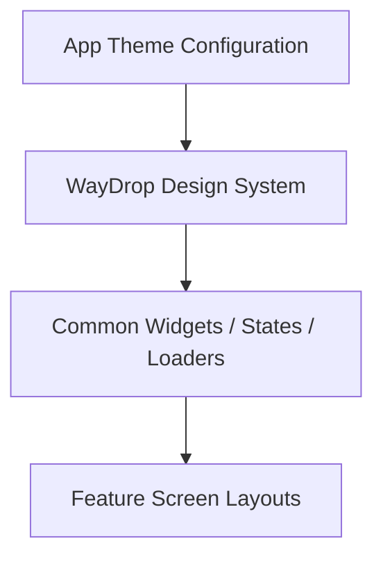

# WayDrop Flutter Codebase — Reusable Widgets Specifications

**Version:** 1.0  
**Last Updated:** July 5, 2026  
**Maintainer:** Lead UI Component Engineer  
**Applies To Commit:** 241d836  

---

## 1. Design System & Component Library

WayDrop's UI is built on a custom design system defined in `lib/design_system/waydrop_design_system.dart`. It includes unified typography, spacing tokens, premium inputs, and themed buttons. The widgets are designed to support both light and dark modes.



---

## 2. Reusable Component Catalog

### 2.1. WayDrop Design System Tokens
- **File Location:** `lib/design_system/waydrop_design_system.dart`
- **Widgets & Utilities:**
  - `WaydropTextStyles`: Defines standard text styles using the Outfit or Inter font families:
    - `displayLarge`: Bold, large title styling (e.g. H1).
    - `titleMedium`: Card headers and menu labels.
    - `bodyMedium`: Secondary description styling.
  - `WaydropButtons`: Custom styled button components:
    - `PrimaryButton`: A filled button using the brand's primary color with loading indicators and disabled states.
    - `SecondaryButton`: An outlined variant.
    - `GlassButton`: A translucent button with backdrops.
  - `WaydropTextFields`: Input fields featuring focus borders, validation states, and prefix/suffix icons.
  - `WaydropCards`: Themed cards with soft shadows, custom border radii, and background gradients.
- **Theme Integration:** Utilizes `Theme.of(context)` to resolve colors like `surface`, `onSurface`, and `primary`, maintaining consistency across both light and dark themes.

---

### 2.2. Interactive 3D & Animation Components

#### `Tilt3DContainer`
- **File Location:** `lib/shared/widgets/tilt_3d_container.dart`
- **Purpose:** Applies a premium 3D parallax tilt effect based on user drag interactions.
- **Implementation:**
  - Wraps widgets in a `GestureDetector`.
  - Uses `SingleTickerProviderStateMixin` with an `AnimationController` to track drag gestures.
  - Applies a `Transform` matrix using perspective calculations:
    ```dart
    Matrix4.identity()
      ..setEntry(3, 2, 0.001) // Perspective coefficient
      ..rotateX(_tiltX)
      ..rotateY(_tiltY)
    ```
- **Inputs:** `child` (widget content), `maxTiltAngle` (default `15.0`).
- **Connections:** Used on login cards, premium landing buttons, and onboarding banners.

#### `WaydropBikeAnimation`
- **File Location:** `lib/shared/animations/waydrop_bike_animation.dart`
- **Purpose:** Renders vehicle animations for searching and loading states.
- **Implementation:**
  - Uses an `AnimationController` and `CustomPainter` to animate vehicle paths.
  - Simulates wheel rotations and road motion.
- **Connections:** Used on `SearchingRiderScreen` and the initial app startup screen.

#### `Waydrop3dBike`
- **File Location:** `lib/shared/widgets/maps/waydrop_3d_bike.dart`
- **Purpose:** Animated 3D vehicle marker overlay.
- **Connections:** Displays active delivery riders on the Ola Map widget.

---

### 2.3. Loading & Shimmer State Components

#### `SkeletonLoader`
- **File Location:** `lib/shared/widgets/skeleton_loader.dart`
- **Purpose:** Renders skeletal placeholder shimmers during database or network requests.
- **Implementation:**
  - Uses a linear gradient that cycles horizontally using a periodic `AnimationController`.
  - Applies a `ShaderMask` to render the shimmer effect on placeholder shapes.

#### `AppSkeletonCard`
- **File Location:** `lib/shared/widgets/states/app_skeleton_card.dart`
- **Purpose:** Standard skeleton card placeholder.

#### `VehiclePricingSkeletonCard`
- **File Location:** `lib/shared/widgets/states/vehicle_pricing_skeleton_card.dart`
- **Purpose:** Skeleton placeholder displayed in the pricing preview bottom sheet while fares are calculating.

---

### 2.4. Utility & Alert Components

#### `ConnectivityWrapper` & `ConnectionErrorScreen`
- **File Location:** `lib/shared/helpers/connectivity_wrapper.dart` and `connection_error_screen.dart`
- **Purpose:** Detects network status and shows an overlay when offline.
- **Implementation:**
  - Listens to connectivity changes using the `connectivity_plus` package.
  - Automatically displays `ConnectionErrorScreen` if the connection is lost.

#### `AppKeyboardWrapper`
- **File Location:** `lib/shared/widgets/app_keyboard_wrapper.dart`
- **Purpose:** Dismisses the keyboard when a user taps outside input fields.
- **Implementation:**
  - Uses a `GestureDetector` that calls `FocusScope.of(context).unfocus()` on tap.

#### `AppSnackbar`
- **File Location:** `lib/shared/widgets/app_snackbar.dart`
- **Purpose:** Displays custom snackbar alerts.
- **Implementation:**
  - Provides static helper methods: `showSuccess()`, `showError()`, `showWarning()`, and `showInfo()`.
  - Applies custom background colors, borders, and prefix icons matching the alert level.
- **Connections:** Triggered by screen controllers to display errors or success messages.

---

### 2.5. Navigation Components

#### `CustomCurvedNavigationBar`
- **File Location:** `lib/shared/widgets/custom_curved_navigation_bar.dart`
- **Purpose:** An animated bottom navigation bar.
- **Implementation:**
  - Animates the selected icon transition using a `CurvedAnimation`.
  - Uses a custom canvas layout to draw the background curve around the active icon.
- **Connections:** Navigation bar for passenger and rider mode tabs.
