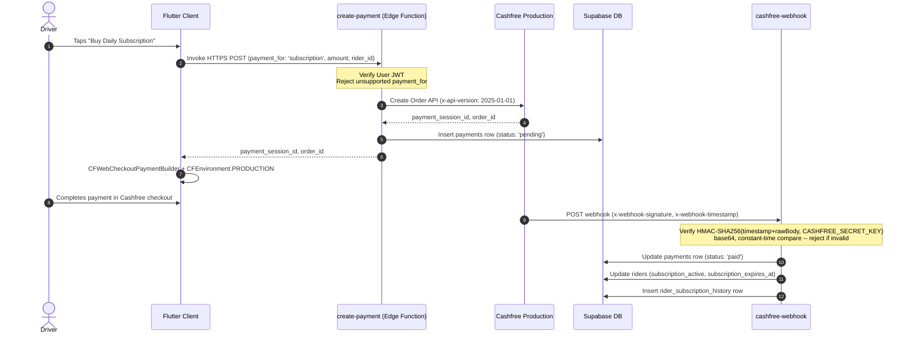

# WayDrop Technical Documentation — Payments Integration

**Version:** 3.0
**Last Updated:** July 25, 2026
**Maintainer:** Lead Payments Engineer

---

## 1. Scope

Cashfree Production is used for two things:
1. The driver's daily/weekly subscription purchase (`payment_for: 'subscription'`) — full hosted
   checkout (`flutter_cashfree_pg_sdk`, `CFWebCheckoutPaymentBuilder`).
2. An always-available fallback for passenger fare collection (`payment_for` = `ride_order` /
   `parcel_order` / `intercity_ride_order` / `intercity_parcel_order` / `ride_sharing`), either as
   full hosted checkout or as a real Cashfree-issued UPI QR (`create-fare-qr`, Order Pay API).

The **default/primary** way a passenger settles a ride/parcel fare is direct, driver-collected
payment — QR-based, not a gateway:

- **Personal QR** — the driver uploads their own real receive-money QR image (captured from
  GPay/PhonePe/Paytm/their bank app) at registration/Payment Settings. This exact image, never
  regenerated or fare-embedded, is shown fullscreen at trip end; the passenger scans it in their own
  UPI app and enters the amount themselves.
- **Cash** — kept as an emergency fallback.
- **Cashfree QR / Checkout** — a genuine gateway-collected option when the driver/passenger prefers
  it, or as a backup if Personal QR doesn't work for them.

For Personal QR and Cash, WayDrop never observes the money movement — the **assigned driver's own
"Confirm Payment Received" action**, after checking their bank/UPI app, is the only thing that marks
the order paid. For Cashfree, only a real, server-verified webhook/poll success can do that; neither
participant can self-report it.

The previous architecture (raw `upi://pay` deep link with an in-app-generated QR from the driver's
typed VPA) was retired after repeated Google Pay / PhonePe security rejections on real devices —
banks/NPCI reliably flag a personal VPA receiving many small pushes from rotating strangers as
mule-account activity, regardless of which UPI app sends it. `payment_mode = 'upi'` and its supporting
columns (`upi_payment_prompted_at`) are left in the schema, handled only so any already-in-flight
order from before this change can still complete; no new order can select it.

## 2. Ride Lifecycle

```
Book → Driver Accept → Start Ride → Ongoing → Destination Reached →
Driver taps End Ride → order_status = payment_pending →
  [driver confirms direct receipt  OR  Cashfree webhook confirms]  →
order_status = completed → Rating
```

`order_status` structurally cannot skip `payment_pending`: the `ongoing` → `completed` transition
does not exist in `update-order-status`'s transition table for ride/ride_sharing/intercity_ride
orders (`ongoing: ["payment_pending"]`, `payment_pending: ["completed"]`). Passenger rating is only
ever reachable from `completed`.

## 3. Passenger Payment Screen

`FarePaymentPanel` (`lib/core/navigation/flow_modules.dart`) shows the canonical payable fare
(`order.payableFare` = `final_fare ?? current_fare`, server-computed, never client-writable — see
`protect_order_financial_columns` trigger) and a single **Pay ₹X** button — a UI entry point only,
it never itself moves money or builds a payment request. Tapping it opens **"Choose Payment
Method"**: two equally-weighted, first-class cards, **UPI Apps** ("Pay using a UPI app") and
**Cash** ("Pay ₹X directly to your Drop Partner") — Cash is never a small text link here.

Picking **UPI Apps** opens **"Choose UPI App"** (`UpiAppLauncher`,
`lib/modules/payments/services/upi_app_launcher.dart`): a list of the UPI apps actually detected as
installed (Google Pay / PhonePe / Paytm / BHIM), or a "No supported UPI apps detected" sheet
(**Try Again** / **Pay Cash**) if none can be reliably detected. Picking an app only brings **that
app itself** to the foreground — on Android via `PackageManager.getLaunchIntentForPackage(package)`
through a small platform channel (`com.waydrop.app/upi_apps`, `MainActivity.kt`), its own bare
custom URL scheme on iOS — carrying no data, no query parameters, no payee VPA, no amount, no order
code, no note. The passenger then uses that app's own QR scanner on the Drop Partner's displayed
Personal QR and types the amount themselves.

Picking **Cash** (from either "Choose Payment Method" or the UPI fallback sheet) records the
passenger's choice directly, with no gateway/intent involved. "Having trouble paying?" remains a
backup escape hatch from the waiting state (Cash, or "Pay Online Securely" — Cashfree hosted
checkout).

Android app detection previously used the `android_intent_plus` package's
`canResolveActivity()`, which calls `PackageManager.resolveActivity(intent, MATCH_DEFAULT_ONLY)` —
that flag requires the target activity to declare `category.DEFAULT`, which LAUNCHER-only
activities (i.e. every app's home-screen icon, including GPay/PhonePe/Paytm/BHIM) never do. That
made detection silently return zero apps on real devices even with the correct
`AndroidManifest.xml` `<queries>` block in place, permanently falling through to the old
instructions sheet. It was replaced with the native `getLaunchIntentForPackage` check above, which
is what `PackageManager` itself uses to resolve a home-screen icon tap and does not require
`category.DEFAULT`.

This panel never constructs or launches a `upi://pay` (or any other) payment intent, and never
sends an amount, order code, note, or reference to a UPI app. An earlier "UPI Apps" button did
exactly that, prefilled with the exact fare and a `WayDrop <order_code>` note — real-device testing
showed GPay rejects that pattern outright ("declined for security reasons"), so it was removed and
replaced with the no-payment-data app opener described above. `mark_fare_payment_attempted` still
records the passenger's declaration (`personal_upi` / `cash` / `cashfree`) so the driver's screen
and the completion guard know what to expect — this is purely informational bookkeeping, never
itself financial (nothing here ever sets `payment_status`).

The driver's Personal QR / Cashfree QR (below) are a separate, always-available channel the
passenger can pay through even without touching this panel at all — Personal QR is the driver's own
uploaded static image, scanned directly by the passenger's own UPI app, with the amount entered
manually by the passenger (never embedded by WayDrop).

## 4. Driver Payment Screen (`rider_active_order_screen.dart`)

The instant `order_status` becomes `payment_pending`, the assigned driver sees:

```
Payment Pending
Ride Fare: ₹X

[ Personal QR ]   [ Cashfree QR ]

[ Swipe to Confirm ₹X Received ]
```

This is shown immediately, independent of anything the passenger does in-app (the passenger may pay
by scanning the Personal QR entirely outside the app).

- **Personal QR** opens the driver's own uploaded, static QR image fullscreen with the fare and the
  instruction: *"Scan this QR using your preferred UPI app. Enter at least the ride fare. You may
  pay more if you wish to add a tip."* The fare is never embedded into the QR; any amount above the
  fare is a voluntary tip WayDrop never learns the exact value of (no NPCI settlement confirmation
  reaches WayDrop for this direct P2P payment) — `current_fare`/`final_fare` are never modified for it.
- **Cashfree QR** calls `create-fare-qr`, which creates/reuses a standard Payment Gateway order
  (`POST /pg/orders` — the same product `create-payment` already uses for subscriptions and the
  passenger's "Pay Online Securely") restricted to UPI only via `order_meta.payment_methods: "upi"`,
  then opens that order's `payment_session_id` through `CFWebCheckoutPaymentBuilder` — the same
  hosted-checkout SDK already used elsewhere in the app. Cashfree's own checkout has a built-in
  "Scan and Pay" feature that renders a genuine, unique, per-order dynamic UPI QR **inside its own
  checkout UI**; the driver holds the phone up so the passenger can scan it with any UPI app. This
  is a deliberately different mechanism from a raw, WayDrop-rendered QR image: Cashfree's only
  documented API for a raw/extractable QR *payload* is `POST /pg/orders/sessions`
  (`payment_method.upi.channel: "qrcode"`, the "Orders Pay"/Seamless S2S API), which **remains
  blocked at the account level** — production calls consistently return HTTP 400,
  `code: "s2s_enabled_not_approved"`, `type: "feature_not_enabled"`, confirmed by Cashfree's own
  docs as requiring PCI-DSS compliance plus explicit Cashfree account-manager/support approval
  neither self-enableable from the merchant dashboard nor related to the separately-licensed
  Payouts "Verification Suite" this account also lacks. The mobile `flutter_cashfree_pg_sdk`'s own
  `CFUPIPaymentBuilder` was also checked and only supports `COLLECT`/`INTENT` modes — no QR mode
  exists client-side either — so there is no way to get a raw QR payload without that same blocked
  S2S grant. Using Cashfree's own hosted-checkout QR instead needs no such approval. The one UX
  trade-off: the driver may need one extra tap ("UPI" → "Scan and Pay") inside Cashfree's checkout
  screen rather than an instant custom QR graphic — `PaymentProcessingScreen` shows that
  instruction plus the existing realtime/poll "waiting for payment" state and a manual refresh, and
  reuses the exact same server-authoritative webhook/poll confirmation (below) as every other
  Cashfree-collected fare. If `create-fare-qr` can't even create the underlying order
  (network/account error), the button instead shows a fixed, non-technical "Cashfree QR is
  temporarily unavailable. Please use Personal QR or Cash instead." message — never Cashfree's raw
  error code/type/message or an HTTP status; the full diagnostic is logged server-side and
  persisted to `payments.metadata.cashfree_qr_last_error` for engineering/support use. This never
  fabricates a QR locally.
- **Confirm Payment Received** is the driver's own attestation for a direct settlement
  (`update-order-status`, `settlement_method: 'personal_upi' | 'cash'`). Server-enforced: only the
  assigned driver (never the passenger) may call this; it can't happen before `payment_pending`; and
  it can't happen twice (optimistic-lock `UPDATE ... WHERE order_status = <expected>`).

If the order's `fare_payment_method` is already `'cashfree'` (passenger paid via their own Pay ₹X →
Pay Online Securely, or scanned the Cashfree QR) and it isn't confirmed yet, the driver instead sees
a waiting banner; once the webhook flips `payment_status = 'paid'`, a plain "Swipe to Complete Ride"
appears — no self-attestation involved for a gateway-confirmed payment.

## 5. Wallet / Commission Accounting

`update-order-status`'s completion handler branches on `fare_payment_method`:
- `personal_upi` / `cash` (direct collection) → the driver already has the money; only the
  platform's commission share is tracked as `cod_pending_amount`, and the driver's wallet is **not**
  credited again for the same ride earning.
- `cashfree` (platform-collected) → the driver's wallet is credited with `rider_earning` via
  `credit_rider_for_completed_order` (a single atomic `column = column + delta` update).

The optimistic-lock update (`.eq('order_status', currentStatus)`) guarantees this branch runs exactly
once per order regardless of retries/concurrent calls, so neither path can double-credit.

## 6. Driver Subscription Checkout Flow (unchanged)



## 7. Webhook Signature Verification

`supabase/functions/cashfree-webhook/index.ts` verifies every incoming request before touching the
database:

1. Read the **raw** request body as text (never parse JSON first — a re-serialized body won't match
   the signature).
2. Read `x-webhook-timestamp` and `x-webhook-signature` headers.
3. Compute `base64(HMAC-SHA256(timestamp + rawBody, CASHFREE_SECRET_KEY))`.
4. Compare against `x-webhook-signature` using a constant-time comparison.
5. Reject with 400 on any mismatch or missing header, before parsing the payload or writing anything.

## 8. Reconciliation

- **Polling fallback**: `verify-payment` calls Cashfree's `GET /orders/{id}/payments` directly and is
  invoked by the client 5s after opening checkout, then every 10s, and immediately on app resume.
- **Duplicate prevention**: `create-payment`/`create-fare-qr` check for an existing `pending`/
  `processing` payment for the same user + `payment_for` + `reference_id` before creating a new
  Cashfree order.
- **Idempotency**: `verify-payment` and `cashfree-webhook` no-op if the payment is already `paid`.

## 9. Driver Registration / Payout

`create-rider-payout` stores bank details plus an optional UPI VPA (reference/display only — never
used to generate a QR) with driver **self-certification** of ownership (`upi_self_certified`,
enforced server-side, checkbox required whenever a VPA is submitted) — this replaced Cashfree VPA
Verification entirely: the merchant account has no access to the Payouts "Validate Payout API"
(a separately-licensed "Verification Suite" capability). No fake "Verified" badge is ever shown.

The **Personal QR image** is uploaded separately (`set_personal_qr_path` RPC + the private
`driver_personal_qr` storage bucket, path `{rider_id}/...`) and is what passengers actually scan —
completely independent of whether/how the VPA text field is filled in.
