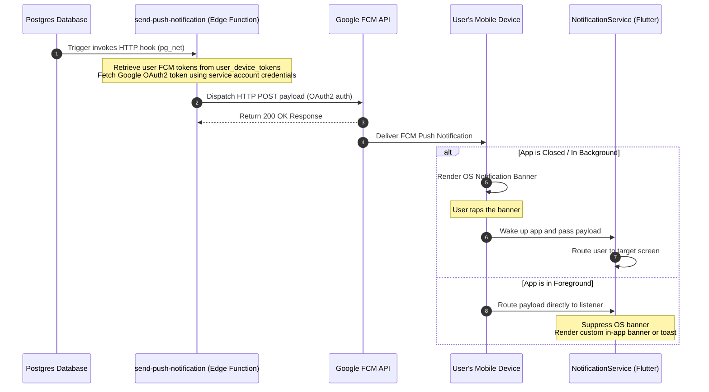

# WayDrop Technical Documentation — Push Notifications

**Version:** 1.0  
**Last Updated:** July 5, 2026  
**Maintainer:** Lead Notifications Engineer  
**Applies To Commit:** 241d836  

---

## 1. Firebase Cloud Messaging (FCM) Flow

WayDrop uses **Firebase Cloud Messaging (FCM)** to send push notifications when the app is in the background or closed.

The diagram below details the end-to-end notification delivery flow:

---

## 2. Client Push Listener Configuration

The client handles incoming notifications using the **`NotificationService`**:

### 2.1. Initialization & Registration
1. **Request Permissions:** Prompts the user for permission to display notifications on first launch.
2. **Retrieve Token:** Fetches the unique FCM token from Firebase.
3. **Register Token:** Saves the token to `user_device_tokens` in the database, mapping it to the authenticated user.

### 2.2. Notification Channels (Android Spec)
To support priority alerts, the service configures a custom notification channel:
- **Channel ID:** `order_alerts_v2`
- **Name:** Order & Security Notifications
- **Importance:** `Importance.max` (Enables sound, vibration, and banner popups over other windows).

### 2.3. Foreground vs. Background Behavior
- **Foreground:** Bypasses standard OS banners to avoid interrupting the user. The app handles the event internally (e.g. updating active screens or showing a custom banner).
- **Background / Terminated:** Handled by a top-level background message handler. The OS displays the banner, and the payload is parsed when the user taps the notification.

---

## 3. Navigation Routing Framework

When a user taps a notification, the **`NotificationService`** parses the `data` payload and routes the user to the correct screen:

| Payload `type` | Parameters | Target Screen | Action |
| :--- | :--- | :--- | :--- |
| `order_status` | `order_id` | `ActiveOrderTrackingScreen` | Loads order progress and starts map tracking. |
| `chat_message` | `order_id`, `sender_id` | `OrderChatScreen` | Opens the chat room for the order. |
| `intercity_request` | `request_id`, `order_id` | `IntercityNegotiationScreen` | Opens the bidding and discussion sheet. |
| `kyc_status` | `status` | `RiderKycScreen` | Routes the rider to the KYC status page (showing approval or rejection reasons). |
