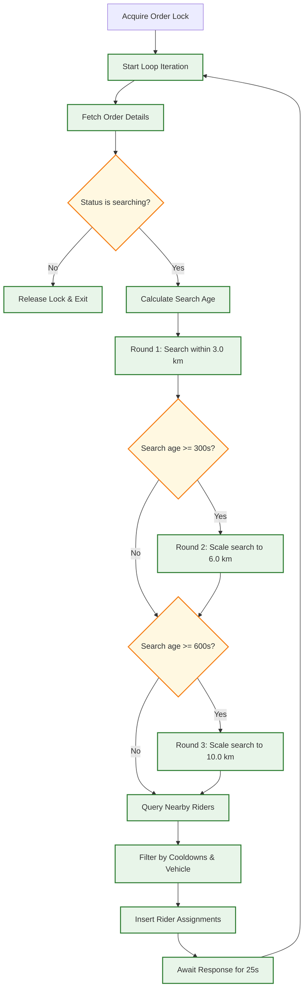

# WayDrop Technical Documentation — Business Logic Rules

**Version:** 1.0  
**Last Updated:** July 5, 2026  
**Maintainer:** Operations Director  
**Applies To Commit:** 241d836  

---

## 1. On-Demand Dispatch & Matching Engine

WayDrop's dispatch engine manages order assignments to nearby online riders using a **distributed lock, multi-round radius-scaling dispatch loop**.

### 1.1. Concurrency Control & Row-Level Locking
To prevent race conditions where multiple background processes attempt to dispatch the same order, the engine implements a row-level locking pattern:

1. **Acquiring a Lock:** When the `start-dispatch` Edge Function runs, it updates the target order row, setting `dispatch_worker_running = true` and `dispatch_worker_started_at = now()`.
2. **Lock Exclusions:** The update statement includes a where clause: `WHERE id = order_id AND (dispatch_worker_running = false OR dispatch_worker_running IS NULL)`. If the update affects 0 rows, the function exits immediately since another worker is already running.
3. **Stale Lock Cleanup:** If `dispatch_worker_running = true` but the lock age (`now() - dispatch_worker_started_at`) exceeds 120 seconds, the engine overrides the lock, assuming the previous process crashed.
4. **Lock Release:** On completion, the function resets `dispatch_worker_running = false`.

### 1.2. Multi-Round Dispatch Loop
The dispatch process runs in a looping worker thread. Each iteration checks parameters from `dispatch_config`:



#### Round 1 (Immediate)
- **Radius:** `round_1_radius_km` (Default `3.0 km`).
- **Batch Size:** `round_1_batch_size` (Default `3` riders).
- **Target Selection:** Filters riders within the radius who match the vehicle requirements.

#### Round 2 (Escalated)
- **Trigger:** Initiates if the order's search age exceeds `round_2_trigger_after_sec` (Default `300 seconds`), or if the `round_2_trigger_if_no_riders_sec` timer expires with no riders found nearby in Round 1.
- **Radius:** `round_2_radius_km` (Default `6.0 km`).
- **Batch Size:** `round_2_batch_size` (Default `5` riders).

#### Round 3 (Expanded)
- **Trigger:** Initiates if `allow_round_3 = true` and the search age exceeds `round_3_trigger_after_sec` (Default `600 seconds`).
- **Radius:** `round_3_radius_km` (Default `10.0 km`).
- **Batch Size:** `round_3_batch_size` (Default `8` riders).

### 1.3. Rider Filtering and Cooldown Logic
When generating matching candidates, the database function `find_nearby_riders` filters out riders based on the following:

1. **Online Status:** The rider's status must be `'online'` with active coordinates set.
2. **Location Freshness:** Coordinates must have been updated within `rider_location_stale_sec` (Default `30 seconds`), or within 24 hours if testing flags are active.
3. **Capacity Limit:** The rider must not exceed `max_active_orders_per_rider` (Default `1`).
4. **Rejection Cooldown:** If a rider rejects an assignment, they are placed on a cooldown of `reject_cooldown_sec` (Default `600 seconds`), during which they will not receive offers for that order.
5. **Timeout Cooldown:** If an assignment expires without a response, the rider is placed on a cooldown of `timeout_cooldown_sec` (Default `120 seconds`).

---

## 2. Fare Calculations & Platform Commissions

### 2.1. Local Fare Structure
Fares are calculated at the time of booking based on the route coordinates:

$$\text{Fare} = \text{Base Fare} + \text{Distance Fare} + \text{Time Fare} + \text{Platform Fee} + \text{Surge Fees} + \text{Taxes}$$

- **Base Fare:** A flat rate based on the vehicle type (e.g. `30 INR` for bikes).
- **Distance Fare:** Calculated per kilometer using the route geometry (e.g. `8 INR / km`).
- **Time Fare:** Calculated per minute of estimated travel duration (e.g. `1.50 INR / minute`).
- **Platform Fee:** A flat fee added to each booking (e.g. `5 INR`).
- **Surge Fees:** Applied during high demand, rain, or late-night hours.
- **GST:** A standard tax rate (e.g. `5%`) applied to the subtotal.

### 2.2. Fare Boosting Splits
Passengers can add a voluntary **Boost Fare** (either a fixed amount or a percentage of the base fare) to attract riders during peak hours:

- **Revenue Split:** The platform takes a smaller percentage of this boost (e.g. `20%`) to cover transaction costs, and passes the remaining `80%` directly to the rider's earnings.
- **Matching Priority:** Boosted orders are prioritized in the dispatch queue.

### 2.3. WayDrop MAX Subscription Rules
Riders can purchase a **WayDrop MAX** subscription to retain more of their earnings:
- **Commission Waiver:** The standard platform commission (e.g. `15%`) is waived for active subscribers.
- **Calculations:** Active subscription status sets `subscription_commission_waived = true` on orders, routing 100% of the base fare and distance charges to the rider's earnings.

---

## 3. Cash on Delivery (COD) & Wallet Settlements

### 3.1. COD Settlement Rules
For cash-based bookings, passengers pay the rider directly at dropoff. The platform commission is deducted from the rider's digital wallet (`wallet_balance`):

- **Wallet Deductions:** The commission amount is calculated and deducted from the rider's balance.
- **Negative Balance Limits:** If the rider's wallet balance drops below a set limit (e.g. `-250 INR`), their account is automatically disabled, preventing them from accepting new orders until they top up their balance.

### 3.2. Payout Withdrawal Rules
Riders can request withdrawals from their wallet balance to their registered bank accounts:

- **Validation Checks:**
  1. The request amount must not exceed the rider's active wallet balance.
  2. The account must have a verified Cashfree beneficiary status.
  3. The request must pass admin verification to ensure earnings are valid.
- **Payout Limits:** Riders are limited to a maximum of 2 withdrawals per 24 hours.
- **Payout:** Approved withdrawals are sent immediately via Cashfree Payouts.
- **Reconciliation:** If a withdrawal fails, the funds are rolled back to the rider's wallet balance.

---

## 4. Live Production Configurations & Database Records Analysis

This section analyzes active database records, detailing how configurations, geofencing, pricing splits, and ID schemes are stored and processed.

### 4.1. Dispatch Configuration Analysis (`dispatch_config`)
The system uses the following configuration parameters for the `DEFAULT_V1` dispatch profile (`64bc8c6f-c683-44ce-bf0e-cfa0cbf408e7`):

* **Round 1:** Searches for riders within a `3 km` radius (`round_1_radius_km`), offering the order to up to `5` candidates (`round_1_batch_size`).
* **Round 2 Scale:** If no response is received within `60 seconds` (`round_2_trigger_if_no_riders_sec`), or if the search age reaches `300 seconds` (`round_2_trigger_after_sec`), the search area scales to a `5 km` radius (`round_2_radius_km`) and offers the order to a batch of `8` riders (`round_2_batch_size`).
* **Round 3 Scale:** If the search continues for `600 seconds` (`round_3_trigger_after_sec`), the search area expands to a `10 km` radius (`round_3_radius_km`) and targets `12` riders (`round_3_batch_size`) in each batch.
* **Timeout & Cooldowns:**
  - **Rider Response Timeout:** Riders have `120 seconds` (`rider_response_timeout_sec`) to accept or reject an offer before it times out.
  - **Rider Rejection Cooldown:** Rejections lock the rider out of matches for `240 seconds` (`reject_cooldown_sec`).
  - **Timeout Cooldown:** If an offer times out, the rider is locked out of matches for `120 seconds` (`timeout_cooldown_sec`).
  - **Location Freshness:** Filters out riders whose GPS coordinates have not updated within the last `30 seconds` (`rider_location_stale_sec`).

### 4.2. Distance Discounts (`distance_discounts`)
The active discount configuration (`25f99ef6-7d22-4a73-9dfd-7cd2c88a55ab`) defines a flat discount rate based on trip distance:
* **5 km Discount:** `12.00 INR` (`km_5_discount`).
* **10 km, 15 km, 20 km Discounts:** Currently set to `0.00 INR`.
* **Execution Logic:** If an order's calculated route distance is $\ge 5$ km, the system deducts a flat `12.00 INR` from the final fare.

### 4.3. User Profile Account (`users`)
An active user profile (`5f5dbeab-0321-46ba-891e-b0e7d33dfb8c`) is structured as follows:
* **UUID:** Mapped to Supabase Auth (`5f5dbeab-0321-46ba-891e-b0e7d33dfb8c`).
* **Phone Number:** Stored as `918328330168` (Muneer Shaik).
* **System Identifiers:**
  - `user_code` = `WDUOMPS2J` (unique alphanumeric code used for client routing).
  - `role` = `user` (passenger privileges).
  - `preferred_mode` = `user` (default client view).
  - `last_active_mode` = `rider` (last active view).
* **Notifications:**
  - All category toggles are set to `true`.
  - `order_notification_mode` = `important_only` (displays only critical status alerts).

### 4.4. Order Transaction Logs (`orders`)

The system records trip details using the following schemas:

#### Ride Booking Analysis (`WDR066N7W`)
* **Identifiers:** `id` = `d3c270db-5a1e-435c-ba9d-ff77ee3d4a05`, `order_code` = `WDR066N7W`.
* **Route:** Warangal pickup (`17.988624`, `79.573939`) to Hunter Road destination (`17.9862531649177`, `79.5703770264265`).
* **Distance & Duration:** `1.585 km` (`distance_km`) with an estimated duration of `5 minutes` (`estimated_duration_min`).
* **Pricing & Splits:**
  - **Base Fare:** `25.00 INR` (includes GST).
  - **Boost Amount:** The passenger added a voluntary boost of `41.67 INR` (a `166.68%` increase).
  - **GST:** `5%` tax split (`3.33 INR` GST amount).
  - **Platform Commission:** `10%` commission split (`6.67 INR` commission amount).
  - **Rider Earning:** `60.00 INR` (includes the base fare and their `33.34 INR` share of the boost).
  - **Company Earning:** `10.00 INR` (includes the commission and the platform's `8.33 INR` share of the boost).
  - **Final Billed Fare:** `70.00 INR` (base fare + boost + taxes).
* **Metadata:**
  - `payment_mode` = `cash`, `payment_status` = `pending`.
  - Verification codes: `pickup_otp` = `3748`, `delivery_otp` = `5347`.
  - IP Address: Order created from IP `152.57.186.69`.
  - Device: Android device (Google/Android, model `X6711-16.2.0.120SP13(IN003PF001H2)`).

#### Local Parcel Booking Analysis (`WDPC4ENS2`)
* **Identifiers:** `id` = `9aaf4183-f0ee-46e8-8d83-277ad2cdb896`, `order_code` = `WDPC4ENS2`.
* **Details:** Auto parcel delivery, cancelled by the passenger after dispatch.
* **Receiver:** Abhiram Senior(ECE) (`7396670369`).
* **Parcel Details:** Weight category set to `35 kg`, with parcel verification photos stored in the `parcel_images` bucket:
  `["https://yvwpchffctiagevpqgwy.supabase.co/storage/v1/object/public/parcel_images/parcels/1782827858781_scaled_33efe610-db94-4f03-8ba9-94ca5b505c526857866534868447970.jpg"]`

### 4.5. Cashfree Payout & Gateway Transactions (`payments`)
The payments table logs transaction requests initiated via Cashfree:

* **Payment Code:** `WDX-RIDE_ORDER-20260705-6125` (mapped to Cashfree's `order_id` parameter).
* **User ID:** Linked to account profile `5f5dbeab-0321-46ba-891e-b0e7d33dfb8c`.
* **Amount:** `42.30 INR` (`final_amount`).
* **Payment Status:** `pending`.
* **Metadata JSON:** Archives Cashfree session parameters used to render the checkout sheet:
  ```json
  {
    "cashfree": {
      "cf_order_id": "6349036796",
      "order_status": "ACTIVE",
      "order_amount": 42.3,
      "order_currency": "INR",
      "payment_session_id": "session_lGDU7v82UZGq_-kOJ8acpiiFxk1...",
      "order_meta": {
        "return_url": "https://yvwpchffctiagevpqgwy.supabase.co/functions/v1/create-payment?action=status_check&order_id=WDX-RIDE_ORDER-20260705-6125"
      }
    }
  }
  ```

---


## 5. Intercity Declared-Route Corridor Matching (Via Locations)

The traveller may declare the exact ordered corridor they intend to travel by adding optional
**Via locations** between From and To on the Post Travel Plan screen. That declared route
(`Origin -> Via 1 -> Via 2 -> ... -> Destination`) becomes the primary signal for matching
passengers whose trip lies *along* the traveller's route, in the correct direction -- not just at
its two endpoints.

This replaces the earlier "choose one of Ola's route alternatives" picker: selecting the
shortest Ola alternative did not reliably produce the practical route (Ola returned e.g. 246 /
300 / 315 km for Bhadrachalam->Guntur, none passing through the expected towns). An explicit Via
list removes the guesswork.

### 5.1. UI behavior (`PostTravelPlanScreen`)

- **Where:** a "Your Route" section that appears **after** From and To are both selected, above
  "Travel Plan Type". The existing From/To fields, vehicle selection, plan type, capacity,
  date/time and pricing UI are unchanged.
- **Optional:** the section starts with just a **"+ Add Via Location"** button; adding zero Via
  locations is fully valid and creates a normal direct plan.
- **Add:** tapping "+ Add Via Location" appends an empty Via row with its own search box. The row
  reuses the existing Ola autocomplete (`OlaMapService.autocomplete`) + place/address geocoders
  (`getCoordinatesFromPlaceId` / `getCoordinatesFromAddress`) -- no new map SDK.
- **Order:** the row's position in the list **is** the travel order and is never reordered.
  Waypoints are stored with an explicit `order` index and `type` (`origin`/`via`/`destination`).
- **Remove:** each Via row has an `x` button.
- **Cap:** `PostTravelPlanScreen.maxViaStops` (currently **5**). This is a product cap that bounds
  worst-case plan-creation latency (the multi-leg builder issues `stops - 1` routing calls); it
  is **not** an Ola constraint. Change the one constant to change the limit. Once the cap is
  reached the "+ Add Via Location" button is replaced with a "Maximum N Via locations." note.
- **Validation** (blocks submit with a SnackBar, mirrors existing validation style):
  1. A Via row with text typed but no location picked from the suggestions.
  2. Invalid coordinates (`|lat|>90`, `|lng|>180`, or `0,0`).
  3. Via location within ~220 m of the departure location.
  4. Via location within ~220 m of the arrival location.
  5. Two Via locations within ~220 m of each other.
  - Empty (never-touched) Via rows are silently ignored and dropped on submit.

### 5.2. Storage

Additive-only columns on `rider_travel_plans`
(`20260905000001_add_selected_route_columns.sql`), all `jsonb`/`text` **nullable, no default** --
every pre-feature row is `NULL` and untouched (section 5.6):

| Column | Purpose |
|---|---|
| `selected_route_geometry` | `jsonb` -- one `[[lat,lng],...]` polyline stitched from the ordered legs. Same shape as `route_geometry`, but declared-corridor intent, not a raw O->D provider polyline. `NULL` when the traveller added no Via locations. |
| `selected_route_meta` | `jsonb` -- `{ waypoints:[{order,type,label,lat,lng,along_track_km}], total_distance_km, provider:'ola', built_via:'multi_leg', leg_count, selected_at }`. `along_track_km` is the cumulative multi-leg **road** distance from the origin to that waypoint. `total_distance_km` is used **only** for matching. |
| `route_selection_status` | `text` -- `'via_declared'` (>=1 Via location, route built and stored) or `'none'` (direct plan). `NULL` for pre-feature rows. |

`route_geometry` / `distance_km` keep their exact current meaning and their **only** source: the
canonical, unchanged `OlaMapService.getDirections()` O->D call.

**PRICING SEPARATION -- unchanged (Option C):**

| Source | Controls | Never controls |
|---|---|---|
| Canonical `getDirections()` O->D call | `route_geometry`, `distance_km`, `base_fare_per_seat` / `gst_amount_per_seat` / `price_per_seat` (via `PricingController.fetchMultiplePricing`) | matching intent |
| Declared Via route (`getMultiStopRoute()`) | `selected_route_geometry` / `selected_route_meta` / `route_selection_status` -- matching intent | any `route_geometry` / `distance_km` / fare field |

The declared-route build in `_submitTravelPlan()` runs **after** the pricing block and its
`total_distance_km` is never read by pricing. A traveller adding Via locations that make the
route longer or shorter does **not** change the fare they were quoted.

### 5.3. Multi-stop routing (`OlaMapService.getMultiStopRoute`)

Ola's Directions API is **only** used the way it is already used in production
(`/routing/v1/directions`, `origin` + `destination`, `routes.first`). No Ola multi-waypoint
request parameter is used -- its exact name/format could not be verified from official docs
without a live diagnostic, so it is deliberately not relied on.

For stops `[Origin, Via 1, ..., Via k, Destination]`:
1. Request each consecutive pair as its own leg via the existing `getDirections()`
   (`k + 1` legs).
2. If **any** leg returns `null`/empty -> `getMultiStopRoute` returns `null`. The screen then
   shows *"Could not build a route through your Via locations..."* and **aborts** -- no plan row
   is inserted, so a partial/corrupted declared route is never persisted.
3. Concatenate leg polylines, dropping a leg's first point when it coincides (<~0.1 m) with the
   previous leg's last point.
4. `total_distance_km` = sum of leg distances. `along_track_km[i]` = sum of legs `0..i-1`
   (`along_track_km[0] = 0`, `along_track_km[last] = total_distance_km`).

### 5.4. Matching algorithm

`selected-route-corridor.ts` -- `computeSelectedRouteMatch(waypoints, totalDistanceKm,
passengerPickup, passengerDestination, cfg)` -> `{ isMatch, tP, tQ, snappedP, snappedQ, reason }`.
Pure function, no DB/network. Config (`production_config.extra_flags`-overridable, same pattern
as `GeometricCorridorConfig`): `snapRadiusKm` (default = existing `intercity_corridor_radius_km`,
**15**), `minSegmentKm` (default **5**).

Steps:
1. Snap passenger **pickup** to the nearest declared waypoint. No waypoint within `snapRadiusKm`
   -> `reason="outside_selected_route_corridor"`, no match.
2. Same for passenger **destination** -> `tQ`.
3. `tP > tQ` (pickup snaps to a waypoint *after* the destination's) ->
   `reason="reverse_of_selected_route"`, no match -- this is the direction/order guard.
4. `tQ - tP < minSegmentKm` -> `reason="leg_too_short"`, no match.
5. Else -> **match**.

Nearest-**waypoint** snapping (not nearest-point-on-polyline) is a deliberate, spec-sanctioned
approximation: waypoints are the named towns the traveller chose, and the 15 km snap radius is
the same tolerance the existing corridor check already uses, so a passenger in the *surrounding
area* of a Via (not exactly on its coordinate) still matches.

**Worked example** -- traveller declares `Bhadrachalam -> Kothagudem -> Tiruvuru -> Vijayawada ->
Guntur`:

| Passenger | Result | Why |
|---|---|---|
| Tiruvuru -> Guntur | **MATCH** | `tP` (Tiruvuru) < `tQ` (Guntur), leg >= 5 km |
| Vijayawada -> Guntur | **MATCH** | forward, adjacent waypoints |
| ~8 km from Tiruvuru -> Guntur | **MATCH** | pickup snaps to Tiruvuru (within 15 km) |
| Guntur -> Tiruvuru | **NO MATCH** | `tP` (Guntur) > `tQ` (Tiruvuru) -> `reverse_of_selected_route` |

### 5.5. Integration into `match-intercity-riders` -- ADDITIVE-ONLY

In **both** Mode 1 and Mode 2, inside a block guarded by `selected_route_geometry IS NOT NULL`:

```
const declaredRoute = computeSelectedRouteMatch(...);
if (declaredRoute.isMatch) { isMatched = true; }   // only ever sets true
```

- It **only ever sets `isMatched = true`** -- never `false`, never AND-composed. It cannot veto a
  legacy city / coordinate / `route_geometry`-proximity match.
- Effective composition:
  `isMatched = cityMatched OR coordinatesMatched OR route_geometry-proximity OR declaredRoute.isMatch`
- Every plan with `selected_route_geometry = NULL` (all pre-feature plans, and every new plan
  created without Via locations) **skips the block entirely** -- byte-for-byte unchanged matching.
- The `geometric-corridor.ts` shadow is **not** promoted -- it stays log-only. Only the
  declared-route signal is gating, and only additively.
- A `[MatchIntercity][SelectedRoute] mode=1|2 ... oldDecision=... newDecision=... reason=...`
  diagnostic line is logged for every evaluated pair.
- Mode 2's trigger (`on_rider_travel_plan_insert()`) forwards the three columns in its payload --
  `20260905000002_forward_selected_route_fields_to_mode2_trigger.sql`, unchanged.

### 5.6. Backward compatibility

- Every pre-feature row: all three columns `NULL`; matching unchanged; never retroactively
  re-prompted.
- No backfill, no destructive change. A plan created with no Via locations behaves exactly like a
  pre-feature plan (`route_selection_status = 'none'`, the three geometry/meta fields `NULL`, the
  declared-route matcher skipped).
- Changing a declared route = cancel + recreate (the existing `cancel_travel_plan_by_traveller`
  flow); there is no in-place edit path for any `rider_travel_plans` field, and this feature adds
  none.

### 5.7. Tests

- `supabase/functions/match-intercity-riders/selected-route-corridor.test.ts` (Deno, pure):
  forward match at endpoints, forward at interior waypoints (Kothagudem->Vijayawada),
  Tiruvuru->Guntur and Vijayawada->Guntur match, Guntur->Bhadrachalam / Guntur->Tiruvuru reverse
  rejection, pickup ~8 km off a Via still matches, outside-snap-radius rejection, leg-too-short,
  empty-waypoints safety.
- `test/intercity_selected_route_matching_regression_test.dart`: the declared-route block is
  called once per mode, guarded by `selected_route_geometry`, and is **additive-only**
  (`isMatched = true` only, never `false`, never AND); the geometric shadow stays shadow-only.
- `test/travel_plan_via_locations_regression_test.dart`: the Via UI (cap constant, ordered list,
  add/remove/validate helpers, reuse of existing geocoders, section gated on From+To); the
  multi-leg builder (per-pair `getDirections()`, `null` on any leg failure, abort-before-insert);
  `getDirections()` unchanged; the old alternatives API surface is gone.
- `test/travel_plan_pricing_route_separation_regression_test.dart`: canonical call drives
  `route_geometry`/`distance_km`/pricing; the declared Via route drives only `selected_route_*`;
  the two never cross-feed.
- `test/mode2_selected_route_trigger_payload_regression_test.dart`: the Mode 2 trigger payload
  forwards the three columns, additively.
