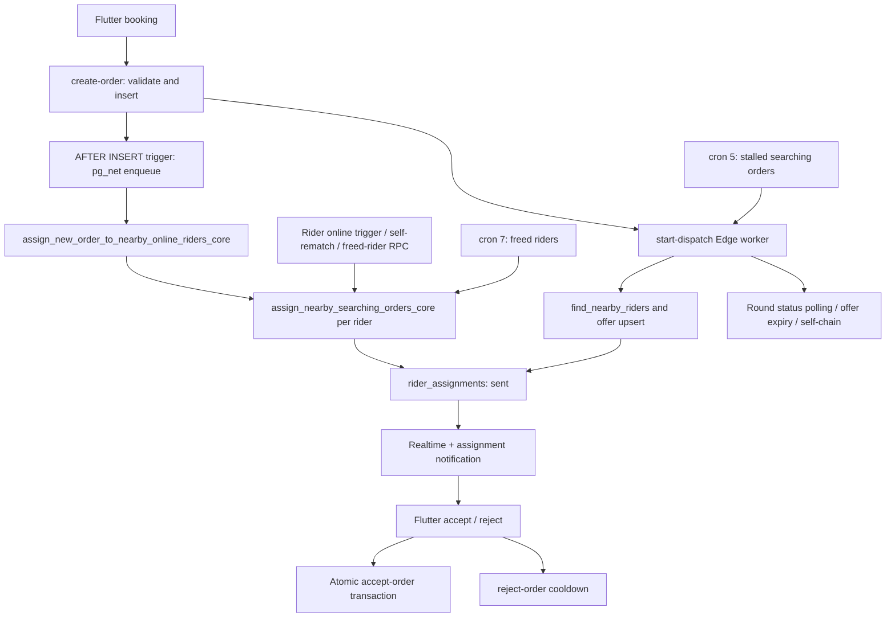

# Part 3 — Order dispatch, cron recovery and rider matching

Project: `yvwpchffctiagevpqgwy`. Incident: **1 November 2026, 16:22–16:34 UTC / 21:52–22:04 IST**. Production inspection was read-only. Parts 1 and 2 and the current main report were read; their fixes are preserved.

## Findings and classification

**The initiating database-wide slowdown cause was not established.** This pass found reproducible recovery defects and avoidable dispatch work, with four targeted local changes. No cron, trigger, index, policy, function or deployment was changed in production.

| Finding | Classification | Action / evidence |
| --- | --- | --- |
| Re-offers insert an already existing unique audit key | **Verified workload amplifier**, with an incident manifestation | Native replay: six valid boosted re-offers cause six caught audit exceptions before, zero after. Incident PostgreSQL `23505` on `unique_order_rider_assignment` at **16:24:59.761 UTC** matches this constraint. It precedes the severe slowdown but does not establish its cause. SQL and Edge audit writes now ignore that specific duplicate key locally. |
| Searching order with a crashed worker's true flag is excluded by the recovery cron | **Proven cause of a local reproduced recovery failure**, not a proven incident cause | Old selector only accepts false/null worker flags; its cleanup only clears old flags on non-searching orders. Candidate selector can enqueue stale or timestamp-less searching leases; Edge null-timestamp CAS is fixed. Three synthetic recoverable cases versus one before. Stale-owner fencing remains a production gate below. |
| Freed-rider recovery invokes matching despite zero searching orders | **Verified workload amplifier** | Three empty sweeps invoke the rider core three times before, zero after. Candidate early existence check retains the nonempty fallback. |
| Ordinary rejection reads remaining offers, then never uses the result | **Verified workload amplifier** | Actual handler model: assignment SELECTs fall from two to one per ordinary rejection, with unchanged rejection write/response and no new dispatch invocation. Query removed locally. |
| New-order booster loops nearby riders, then each rider-core call scans all eligible searching orders | **Verified workload amplifier by source structure**; incident contribution unmeasured | Work can grow with nearby riders × searching orders, even though the trigger was for one order. Previously prepared latitude-prefilter proposals remain unchanged; no speculative function rewrite or new index here. |
| Trigger, cron, self-rematch and Edge paths can overlap | **Suspected contention/duplicate-work risk requiring measurement** | Different lock domains; unique offer key prevents duplicate pair rows, but does not prevent repeated reads/calculations or all re-offer races. Incident RPC totals establish activity, not same-order concurrency or a blocking chain. |
| Cron job 5 at 9.656 s and job 7 startup failure at 11.669 s | **Incident symptoms** | Both occur after broad latency/timeout trouble. Startup timeout is not proof of 11.669 s executing the matching function. No cron schedule was disabled or lengthened. |
| “pg_cron runs two copies of the same scheduled job simultaneously” | **Ruled out as a general scheduler explanation** | pg_cron queues the next invocation of a particular job until its current invocation completes. Distinct jobs/manual/trigger/HTTP calls can still overlap. Existing source comments claiming otherwise are historical and are not relied on here. [pg_cron documentation](https://github.com/citusdata/pg_cron#how-pg_cron-works). |

## Complete flow and source coordinates

| Stage | Exact implementation |
| --- | --- |
| Booking | `lib/features/local_rides/booking/screens/ride_location_screen.dart:1843` invokes `create-order`; parcel equivalent `parcel_booking_screen.dart:471`. Existing request-id/reconciliation logic is not replaced. |
| Primary dispatch | `supabase/functions/create-order/index.ts`: after committing the local order, independently invokes `start-dispatch`, ahead of noncritical bookkeeping. Current deployed create-order is **version 78**, captured in evidence. |
| New-order booster | Trigger `trigger_assign_new_order_to_nearby_riders` → `assign_new_order_to_nearby_online_riders()` → asynchronous `net.http_post('/rest/v1/rpc/assign_new_order_to_nearby_online_riders_core', p_order_id)`. Core reads that order, finds online riders within round-2 radius, then calls the all-searching-orders rider core for each. |
| Online trigger | `trigger_assign_nearby_orders`: only an actual transition into online → `assign_nearby_searching_orders_to_rider()` → synchronous rider-core matching in the online-status transaction. GPS-only updates do not fire this UPDATE OF account_status transition trigger. |
| Rider freed | Orders trigger `trigger_assign_nearby_orders_on_rider_freed` → `assign_nearby_searching_orders_on_rider_freed()` → pg_net rider-core RPC. Its trigger's old/new busy-state lists differ from the cron's busy-state list, including missing `rider_at_drop`; this is an existing transition-coverage risk, not changed here. |
| Client fallback | `lib/features/rider/orders/rider_orders_screen.dart:658–670`: busy→free reconciliation calls `rider_self_rematch()`, which resolves the authenticated user's rider and invokes the same rider core. Preserved. |
| Recovery cron | Job 5: `redispatch_stalled_searching_orders()`, **every minute**. Job 7: `redispatch_freed_riders()`, **45 seconds**. Current job 1 expires stale searches every **two minutes**; older comments saying 15/20-second recovery or one-minute expiry are not current schedules. |
| Worker ownership | `supabase/functions/start-dispatch/index.ts:230–300`: read current flag/timestamp; atomic conditional UPDATE acquires it. `dispatch_worker_started_at` is both lease timestamp and release token. Existing chain/finally release filters at **820 and 876** retain exact-token ownership. |
| Worker rounds | `start-dispatch/index.ts:450–540`: read assignment exclusions first, call six-argument `find_nearby_riders` with exclusions, retain vehicle/weight checks, upsert offers. Status RPC polls every three seconds; `sent` status gates timeout updates; chained worker preserves recovery. |
| Offer delivery | `on_rider_assignment_change()`: notify on INSERT sent or transition into sent, not every sent→sent update. Notifications and Realtime are separate downstream effects; pg_net network delivery is asynchronous. |
| Acceptance | `rider_orders_screen.dart:1177` invokes `accept-order`; current local `supabase/functions/accept-order/atomic_acceptance.ts` runs the transaction from `acceptance_sql.ts`. Rider and order locking, actor validation, eligibility, fares and idempotency are unchanged. This pass does not claim the current local handler has been deployed. |
| Rejection | `rider_orders_screen.dart:1260` invokes `reject-order`; owns authentication, rider ownership, searching/status validation, rejection timestamps and four-minute cooldown. Worker/cron owns further dispatch; rejection does not spawn a parallel worker. |
| Expiry | Worker round expiry updates only `assignment_status='sent'`. `expire_stale_searching_orders()` terminally expires local orders older than configured search duration and closes their sent offers/logs; cron remains enabled. Its purpose is overall search expiry, not a generic per-offer expiry sweep. |

Exact SQL bodies, triggers, unique constraints and indexes are captured in [CATALOG.json](dispatch-cron-20261102/CATALOG.json), [EXTRA_CATALOG.json](dispatch-cron-20261102/EXTRA_CATALOG.json), and individual `*.captured.sql` files in the evidence directory. Captured deployed Edge sources are `production-start-dispatch.ts` (**v72**), `production-create-order.ts` (**v78**) and `production-reject-order.ts` (**v18**). These are evidence snapshots, not new deployable entry points.

## Lock coverage, re-offers and unnecessary work

The two sweep functions use **different** transaction advisory locks: `(4735021,1)` for freed riders and `(4735021,2)` for stalled orders. They exclude concurrent invocations of that same function, including manual calls. They do not exclude each other, the online trigger, self-rematch, new-order core, or Edge workers. Their locks end with the SQL transaction, **not** when an asynchronously enqueued worker finishes.

Edge's per-order flag/timestamp CAS excludes simultaneous primary worker acquisition. It is not a lock taken by the rider-centric SQL core. The unique `rider_assignments(order_id,rider_id)` constraint prevents two physical offer rows for one pair; it does not eliminate duplicate eligibility/distance work, serialize offers against acceptance, or make blind offer upserts safe in every stale-snapshot race. No global lock was introduced that could strand orders when an entry point returns or fails.

The rider core reads dispatch config/KYC vehicle and checks tax/COD, scans fresh searching orders, computes Haversine distance, required mode and vehicle/parcel-weight compatibility, then probes existing offers. Existing sent/accepted rows are not normally re-offered. Expired rows need a fare increase; rejected rows need both cooldown expiry and a fare increase. These exact rules are unchanged by the audit fix. The core does not simply reuse every predicate in `find_nearby_riders`; caller/trigger coverage must not be mistaken for a complete independent eligibility guarantee.

Current `find_nearby_riders` includes owner authorization, mode/online/tax/COD, existing KYC/activation rules, freshness rules, vehicle/weight and active-trip exclusion, distance ordering and limit. The deployed SQL contains permissive existing pending/inactive/null and freshness fallbacks; this pass does not silently tighten them or label them approved-only. Those policy choices need a separate eligibility review. The existing local optimized-overload and bounding/CTE proposals were not rewritten.

New-order core's radius calculation selects riders for the new order, but calls a rider function that re-scans **all** fresh searching orders. Freed-rider cron can repeat this for multiple riders recently associated with orders. Those scans and synchronous offer writes can hold transaction locks until the entire sweep/online transaction commits. Actual incident wait graphs and inner-function plans are unavailable; loop structure alone is not proof of measured lock contention.

## Local changes and before/after results

### A. Audit duplicate conflicts

`order_assignment_logs` has unique `(order_id,rider_id,assignment_round)`. The rider core always uses round 1, including legitimate boosted re-offers. Its existing inner exception blocks preserve the real offer on an audit conflict but still perform a failing INSERT/subtransaction on each re-offer. Edge also inserts reused audit keys, ignores that error and proceeds.

- [SQL candidate](dispatch-cron-20261102/assign_nearby_searching_orders_core.candidate.sql): **lines 190, 233, 278**, add `ON CONFLICT (order_id,rider_id,assignment_round) DO NOTHING` to the three audit INSERTs only. Existing assignment writes, exception safety and re-offer predicates remain.
- [start-dispatch](../../supabase/functions/start-dispatch/index.ts): **680–683**, use duplicate-ignore upsert with that exact audit key. This preserves an existing accepted/rejected audit state; it does not overwrite it with sent.
- Native before/after: six valid alternating expired/rejected boosted re-offers → **6 audit exceptions before / 0 after**; one authoritative offer row and one audit row retained. Cooldown-blocked rejection still stays rejected; already accepted offer stays accepted in the tested sequential case.

This removes expected unique errors, not all audit attempts. It does not make audit and offer writes one transaction across REST requests or resolve every offer/accept race.

### B. Orphaned worker recovery

Old stalled recovery accepts only false/null worker flags. Its final cleanup clears true flags only for non-searching orders. A killed searching worker can therefore miss this recovery indefinitely until overall search expiry or another explicit invocation steals its stale lease. A true flag with NULL timestamp cannot be stolen by the old Edge code either.

- [Recovery candidate](dispatch-cron-20261102/redispatch_stalled_searching_orders.candidate.sql): **43–52**, retain the false-flag/20-second rule and additionally enqueue true flags whose timestamp is NULL or older than the existing **120-second** stale threshold. Do not blindly clear a live lease before enqueueing.
- `start-dispatch/index.ts:245–282`: NULL-timestamp recovery uses `IS NULL`, not `= NULL`; stale takeover compares both running=true and the exact old timestamp. All acquisitions additionally require **order_status=searching**, avoiding worker-flag writes on already accepted/cancelled orders. Existing exact-token releases are preserved.
- Native selection matrix: old selector enqueues **1/3 recoverable fixtures**, candidate **3/3**; fresh true lease, terminal order and order outside search lifetime are excluded. Twelve concurrent NULL-lease claims have **one** winner; a stale owner's release changes **zero** replacement-lease rows. Node tests also verify fresh-lease exclusion, timestamp CAS and terminal-state acquisition.

**Production gate:** a stale timestamp is not proof its old process has stopped. Current response timeout is **120 seconds**, while the worker's nominal execution cap is **100 seconds** and is checked outside awaited operations. Slow RPCs/round polling can outlive a nominal cap. Exact-token release prevents an old worker from clearing a new lease, but does not fence every old worker's later assignment write. This pre-existing takeover assumption must be validated/fenced before enabling automatic stale-true recovery in production. The SQL is a reviewed local candidate, **not a production-ready guarantee of one executing process**. Timestamp-less recovery and current-owner CAS tests do not prove the resumed-old-worker case.

### C. Empty freed-rider sweep

[Freed-rider candidate](dispatch-cron-20261102/redispatch_freed_riders.candidate.sql): **lines 21–25**, after acquiring the existing advisory lock, return when there are no searching orders. This avoids candidate-rider scanning and core/config/tax/KYC work that cannot produce an offer. It does not disable the job. A new order arriving after this check retains its trigger/primary-worker paths and the next sweep.

Native fixture: three empty sweeps previously called the rider core **3 times**, now **0**; adding a searching order makes the next sweep call the core once. This measurement counts function invocations, not production latency savings. Searches that are present but expired/ineligible may still cause work; no speculative wider filter was added.

### D. Dead rejection query

`supabase/functions/reject-order/index.ts:330–342`: removed the remaining-sent-assignments SELECT and its unrelated failure branch. Its result was never used; `redispatched` was already always false. A successful rejection no longer reports 500 just because this unused follow-up read failed. Actual handler-model requests fall from **two assignment SELECTs to one** for the normal sent/expired rejection branch. Rider ownership, terminal/accepted checks, cooldown writes and response shape are preserved. No dispatch fallback was removed.

### Build compatibility

`supabase/functions/_shared/http.ts:40`: changed only timer type to `ReturnType<typeof setTimeout>`, resolving a Node/Deno ambient-type conflict in the check. Abort/deadline behavior is unchanged. No other shared HTTP behavior was rewritten.

## Incident-specific evidence, plans and causal limits

[INCIDENT.json](dispatch-cron-20261102/INCIDENT.json) separates gateway sources. Database REST logs contain **40 nearby RPCs (max 2,132 ms), 18 self-rematch (max 1,610 ms), 11 rider-core RPCs (max 772 ms), 10 new-order-core RPCs (max 2,753 ms)**. These do not include synchronous trigger calls or every SQL call inside cron.

Function gateway logs separately show **10 create-order calls** (max 3,903 ms) and **10 start-dispatch calls** (max 23,166 ms), no >=500 in those groups. No reject-order function-gateway record was found in this window. An initially incorrect pathname filter returned no rows; it was corrected using captured function IDs and actual `/functions/v1/...` paths. Function wall time includes waits and downstream work, not isolated CPU or matching SQL time.

Selected redacted dispatch traces show real repeated no-progress rounds: **16:25:32.994 and 16:25:35.120 UTC**, nearby returns one rider, then all candidates are already handled. Another worker repeats this at **16:26:30.754, :33.472, :35.848, :38.044**, switching from 2-second retries to 15 seconds; at **16:26:53.261** it observes rider_arrived and exits. The deployed Edge snapshot computes exclusions after the nearby call; the current local source already pushes exclusions into SQL. That existing fix was preserved, not claimed as a new Part 3 implementation. The selected trace query reached its first-100-entry limit at 16:28:57, so it is **not** a complete incident chronology or a duplicate-worker count.

At **16:24:59.761 UTC**, the Part 1 PostgreSQL record contains the audit unique-key exception; the matching dispatch trace commits one offer at :59.700. Timestamp proximity and matching table/constraint support audit contention, but request IDs do not join those two records into a proven single transaction. Neither explains the later database-wide slowdown by itself.

Previously retained cron history supplies job 5 **9,656.285 ms** at 16:33:07.407–16:33:17.063 UTC, and job 7 **startup** failure **11,669.184 ms** at 16:32:36.882–16:32:48.551. Earlier same-window cron execution durations were usually milliseconds. Cron was already a victim of broader trouble; no initiating-cron conclusion is justified.

Current historical nearby-statistics groups include mean **228.459 ms / max 12,089.528 ms**, and another shape max **16,742.946 ms**. May-to-date cumulative statistics mix roles/shapes and cannot locate those maxima in this incident. The current small rider population and current plan are not a historical capacity test.

One lightweight production **EXPLAIN FORMAT JSON without ANALYZE** for the candidate recovery selector retained `idx_orders_searching_created_at`, estimated one row, total cost 1.75. This checks plausible index access, **not** actual runtime, lock waits or a benchmark. Existing order/rider assignment uniqueness and order searching/created/rider indexes were inspected. No index was added and no production function was executed for benchmarking.

## Verification and safety scope

| Test group | Final result | What it proves |
| --- | ---: | --- |
| New native PG17 dispatch tests | **5 passed / 0 failed** | Actual captured SQL functions, selectors, NULL-lease CAS, stale release fencing, audit re-offers, empty sweeps, twelve concurrent rematches → one offer/audit/notification effect. |
| Worker/audit Node tests | **5/0** | Execute actual acquisition source block with a PostgREST model. Old deployed source: **2 pass / 3 expected failures**. |
| Actual rejection handler model | **3/0** | One rather than two assignment SELECTs, ownership/terminal/accepted rejection protection. Old deployed handler: **2 pass / 1 expected failure**. |
| Existing Flutter dispatch/cron/nearby guards | **49/0** | Existing schedules/lock-source guards, self-rematch and canonical eligibility wiring remain. Older comments in those tests are not evidence for scheduler behavior. |
| Existing direct-SQL acceptance suite | **16/0** | Seven independent connections → one winner/six 409s; twelve duplicate accepts → one event/idempotency; one rider/two orders; actor/mode/offline/tax/COD checks; promo/subscription fare; statement/commit rollback; connection-context isolation. |
| Actual acceptance-handler race/recovery suite | **4/0** | Two riders → 200/409 and one accepted assignment, payable fare 90, canonical commission 9.52, loser expired; fail-closed emergency response and successful retry. |
| Deno check | **exit 0** | Local start-dispatch/reject-order source checks with the existing offline Supabase/server import adapter. This is not a managed deployment or live-client integration test. |

**Total: 82 final passing checks, zero final failing checks.** Counts include separate behavior and existing wiring suites; they are not 82 independent production scenarios. Logs: `.dart_tool/part3-native.log`, `part3-edge-tests.log`, `part3-reject-tests.log`, `part3-flutter.log`, `part3-native-acceptance.log`, `part3-handler-final.log`, `part3-deno-check.log`. Native results: [PG17_RESULTS.json](dispatch-cron-20261102/PG17_RESULTS.json); handler/fare result: [HANDLER_RESULTS.json](dispatch-cron-20261102/HANDLER_RESULTS.json).

Initial acceptance attempts failed because a historical harness expected a removed RPC, and the reused synthetic fixture lacked its notification sequence permission and retained two different test-only acceptance-capture triggers. The direct-SQL harness was selected, fixture permissions/claim helper aligned locally, and duplicate **test capture** removed. Final tests passed without modifying acceptance implementation or assertions. An initial Edge model lacked its CORS constant; fixed in the test harness. These failures are not hidden as successful production evidence.

The synthetic cluster is fixed to **127.0.0.1:54329**, dispatch fixture database `waydrop_part3_test`; acceptance uses existing synthetic `waydrop_perf_test`. PostgreSQL schema/role changes occurred only there. pg_net/Vault are local queue/secret placeholders; notification effects are captured rows. No managed Auth, pg_net delivery, FCM or Realtime equivalence is claimed. Tests prove the listed races, not all interleavings of a delayed stale worker, a rider-core UPDATE and an Edge upsert after acceptance.

## Required release actions and Parts 4/5 handoff

1. **No production action has been taken or authorized.** The two Edge functions require reviewed deployments; SQL candidates require separately prepared, hash-checked migrations and rollback. Current before/candidate SHA-256 values are saved in `SQL_SOURCE_HASHES.json`. Do not run a repository-wide migration push. Existing matching wave drift guards need rebasing if this core candidate is approved.
2. Audit deduplication, rejection read removal and empty-sweep avoidance are isolated from the stale-recovery gate. Do not treat all candidates as one approved release. Automatic stale-true recovery requires the resumed-old-owner/fencing test and full response-window review first; both cron fallbacks remain enabled.
3. **Part 4 handoff:** transaction/lock-level tests for Edge offers versus SQL re-offers, rejection and acceptance, including stale snapshots/accepted→sent overwrites, missing timestamp and live worker delayed beyond 120 seconds. The local atomic acceptance transaction is preserved; its independent tests do not prove every competing writer is fenced. Review eligibility differences in the rider-centric core and permissive matching policy against product/security requirements without weakening checks.
4. **Part 5 handoff:** controlled managed staging/load tests covering enqueue delivery failure, worker crash/restart, accepted-order exclusion, no-candidate retries, large searching sets, actual trigger/RLS costs, queue age and per-entry-point query counts. Confirm current compute/waits before claiming latency or CPU savings. Audit already prepared matching proposals rather than reimplementing them.
5. Remaining redundant HTTP risk: multiple asynchronous entry points can enqueue before any worker acquires its row flag; a transaction advisory lock does not cover queue/Edge lifetime. Per-order durable enqueue coalescing/shared conditional offer APIs need a reviewed design; disabling boosters or recovery jobs is not a safe substitute.

**Release status: local verified changes and review candidates only. Dispatch safety is verified for the explicit test matrix; comprehensive cross-writer fencing and managed fault recovery remain gates. Initiating database root cause remains unproven.**
